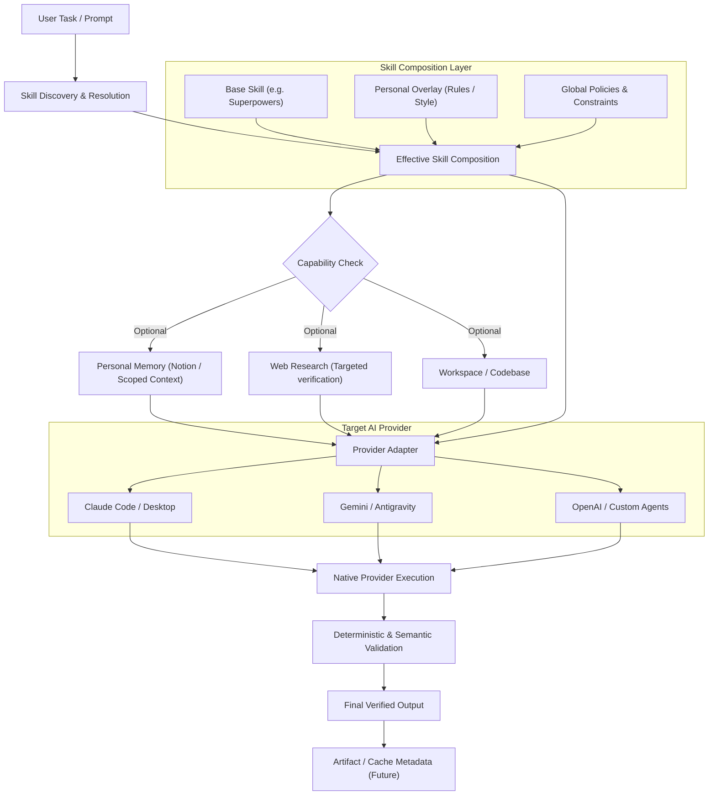

# Anchor Core (skill-shelf)

> **Provider-independent personal memory, reusable skill workflows, and execution adapters.**

---

## 1. Project Overview

**Anchor Core** is an architectural foundation designed to separate personal context, task workflows, and AI provider implementations.

Modern AI usage is fragmented: developers and professionals work across Claude, OpenAI/ChatGPT, Gemini, Kimi, OpenClaw, and specialized agent environments. Each environment defines its own skill format, directory structure, tool integrations, and execution nuances. Consequently, users are forced to repeatedly restate who they are, copy-paste instructions, duplicate external skills, and grapple with vendor lock-in.

Anchor Core solves this with the **Anchor-Brain + Anchor Skills** paradigm:

* **Anchor-Brain**: A provider-independent personal memory and context layer (backed by Notion). Answers *"What is true about Bhargava?"*
* **Anchor Skills**: A provider-independent reusable workflow and skill library (stored in Git / GitHub). Answers *"How should this type of task be performed?"*
* **Provider Adapters**: Thin, swappable translation layers for specific execution environments (Claude, Gemini, OpenAI, etc.). Answers *"How does this environment execute the skill?"*

> [!IMPORTANT]
> Anchor Core is **not** a custom autonomous runtime, not an always-running daemon, not a vector database, and not a replacement for native AI platforms. Native AI environments perform the actual execution; Anchor Core provides the structured definitions, overlays, and adapters.

---

## 2. Core Architectural Pillars



1. **Separation of Concerns**: Personal facts are completely decoupled from task instructions, and task instructions are decoupled from provider execution mechanics.
2. **Base + Overlay Composition**: Upstream external skills (such as `obra/superpowers`) are reused directly as dependencies without forking or cloning. Personal customizations are applied deterministically via overlays (`ADD`, `REPLACE`, `RESTRICT`, `PRIORITISE`).
3. **Capabilities are Explicit & Optional**: Memory, web access, and codebase access are opt-in capabilities. A skill must declare what it needs (`forbidden`, `optional`, or `required`) and request minimum scoped context (`identity.education`, `experience.backend`).
4. **Clean OOP Principles**: System design adheres to Abstraction, Encapsulation, Dependency Inversion, and Interface Segregation (e.g., PDF generation abstracted behind a `PDFRenderer` interface).
5. **One-Analysis / One-Fix Principle**: Avoid iterative multi-turn trial-and-error generation. Perform one comprehensive analysis, produce a complete issue manifest, and execute one consolidated correction pass before final validation.

---

## 3. Documentation Index

Detailed architectural specifications, engineering principles, and phase roadmaps are organized inside the [docs/](file:///d:/skill-shelf/docs) directory:

| Document | Description |
| :--- | :--- |
| [docs/architecture.md](file:///d:/skill-shelf/docs/architecture.md) | Comprehensive system architecture: layers, capability resolution, memory scoping (L0–L4), overlay operations, adapters, and medpack fallback. |
| [docs/design_principles.md](file:///d:/skill-shelf/docs/design_principles.md) | OOP mental models, engineering philosophy, anti-vibe-coding rules, research discipline, and the 18 fundamental Anchor rules. |
| [docs/phase_1_resume_generator.md](file:///d:/skill-shelf/docs/phase_1_resume_generator.md) | Complete specification for the first vertical slice: input contracts, ATS guidelines, JD analysis, evidence mapping, layout engines, PDF renderers, and test matrix. |
| [docs/roadmap.md](file:///d:/skill-shelf/docs/roadmap.md) | Incremental 10-phase delivery roadmap from Phase 1 (Resume Generator) through Phase 10 (Future Automation & Cloud). |

---

## 4. Current Milestone: Phase 1 — Resume Generator

Anchor Core is developed incrementally. The immediate milestone is **Phase 1: Resume Generator Skill**:

```text
Job Description (JD)
       +
Candidate Information & Evidence (Notion / Memory)
       +
Optional Historical Resume
       +
Layout Configuration (1-page 2-col default / 1-col override)
       │
       ▼
Resume Generator Skill
       │
       ├── Deterministic JD & Evidence Mapping (No fabrication)
       ├── Content Engine vs. Layout Engine separation
       ├── Central Typography & Spacing Token System
       ├── Pluggable PDFRenderer interface (e.g. ReportLab)
       └── Multi-tier Validation (Grammar, ATS, Layout, Overflow)
       │
       ▼
High-Quality, Professional 1-Page PDF
```

For the step-by-step implementation guide, contracts, and test cases, read [docs/phase_1_resume_generator.md](file:///d:/skill-shelf/docs/phase_1_resume_generator.md).

---

## 5. Repository Structure

```text
skill-shelf/
├── README.md                           # Project index and architecture overview
├── docs/                               # System specifications and engineering docs
│   ├── architecture.md                 # System architecture and data flow
│   ├── design_principles.md            # OOP mental models and operating rules
│   ├── phase_1_resume_generator.md     # Phase 1 vertical slice specification
│   └── roadmap.md                      # 10-phase project evolution roadmap
└── anchor-skills/                      # Skills library (Phase 1 structure)
    ├── README.md                       # Skills directory overview
    ├── skill/
    │   └── resume/
    │       └── SKILL.md                # Declarative resume skill definition
    ├── config/
    │   └── resume.yaml                 # Configuration, layout, and typography tokens
    ├── references/
    │   └── resume/                     # Detailed domain guidance & checklists
    ├── tests/
    │   └── resume/                     # Structural, grammar, and layout test suite
    └── providers/
        └── claude/                     # Claude-specific adapter and packaging
```

---

## 6. The 18 Cardinal Rules

1. **Memory is optional** — never load memory by default.
2. **Notion is the personal-memory store**, not the skill code repository.
3. **GitHub is the reusable skill source**, not the personal data store.
4. **External skills should be reused**, never copied or forked unnecessarily.
5. **Personal customization should be an overlay**, keeping base skills clean.
6. **Provider-specific behavior belongs in adapters**, not universal skills.
7. **Implementations must remain replaceable** behind stable interfaces.
8. **Skills must explicitly declare their dependencies and capabilities**.
9. **Validation is strictly decoupled from generation**.
10. **Security is an architectural boundary (L0–L4)**, not prompt phrasing.
11. **Do not fabricate personal information** — zero tolerance for unverified claims.
12. **Use the minimum required context** (least privilege).
13. **Perform one complete analysis before correction** (no endless regeneration loops).
14. **Avoid repeated semantic regeneration** — use deterministic logic where possible.
15. **Do not build a universal runtime prematurely**.
16. **Do not over-engineer Phase 1** — build the minimal vertical slice to prove the contract.
17. **Understand every component implemented** (Anti-Vibe-Coding).
18. **Research provider behavior from official docs**, never guess.
