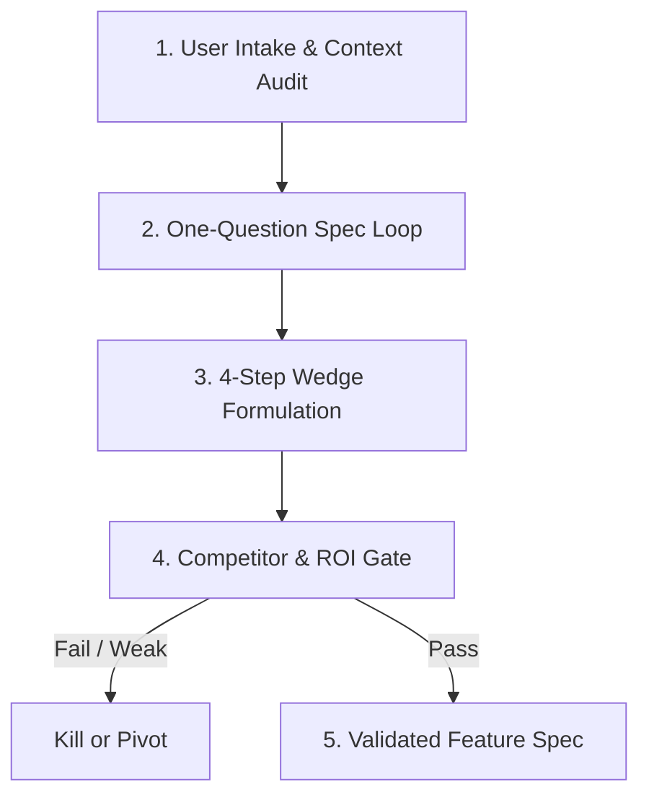
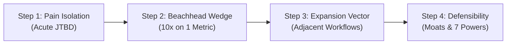
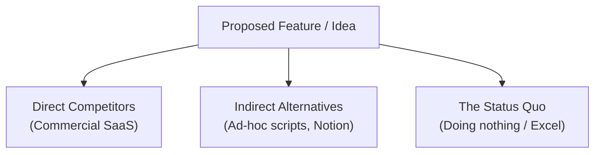
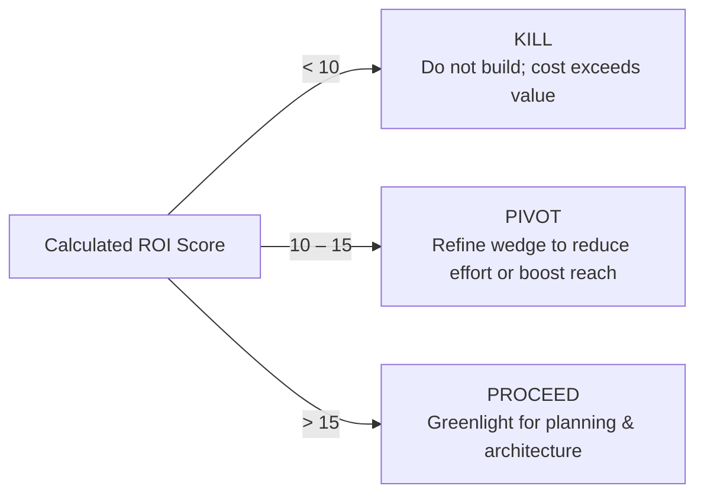

# Brainstorm & Validate Skill

## 1. Purpose & Philosophy
Transform vague ideas and creative impulses into rigorously validated, high-leverage product specifications. Merges 4-step wedge discovery, an uncompromising competitor/ROI gate, and a focused one-question-at-a-time spec loop. Prevents building unneeded software by killing weak ideas early and sharpening strong ones into indispensable wedges.

---

## 2. Core Operational Pillars

### A. 4-Step Wedge Discovery
1. **Pain Point Isolation**: Pinpoint an acute, recurring frustration for a specific Ideal Customer Profile (ICP). Reject broad, generic target markets.
2. **Beachhead Wedge**: Formulate a narrow, high-utility initial feature that delivers 10x value on a single dimension with near-zero friction.
3. **Expansion Vector**: Map the natural sequence of adjacent capabilities unlocked once the beachhead is established.
4. **Defensibility & Moat**: Identify long-term defensibility early (switching costs, network effects, data flywheels, counter-positioning).

### B. Competitor & ROI Gate (Kill / Pivot / Proceed)
* **The "Status Quo" Test**: Evaluate real alternatives—including Excel, pen-and-paper, manual workarounds, and existing tools.
* **Value Equation**:
  $$\text{ROI Score} = \frac{\text{Pain Intensity (1–5)} \times \text{Frequency (1–5)} \times \text{Target Reach (1–5)}}{\text{Implementation Effort (1–5)}}$$
* **Hard Decision Gates**:
  * *Kill*: ROI < 10, fatal regulatory/platform risks, or no clear wedge.
  * *Pivot*: Acute pain identified, but initial wedge is crowded, fragile, or lacks defensibility.
  * *Proceed*: Differentiated wedge, clear ROI > 15, defensible moat pathway.

### C. One-Question-at-a-Time Spec Loop
* **Single Question Rule**: Never fire multi-part questionnaires. Ask exactly one focused, high-leverage question per turn.
* **Playback Before Progress**: Play back current understanding in ~150–200 words, clearly separating confirmed facts from proposed assumptions.
* **Concrete Proposals Over Open Voids**: Rather than asking "What do you want?", offer a sharp proposal with clear trade-offs to react against.
* **Explore Anti-Goals**: Define non-goals and anti-goals (outcomes that constitute failure even if the software works).

---

## 3. End-to-End Workflow



1. **Intake & Recon**: Audit existing repository, user context, and constraints.
2. **Interactive Clarification**: Execute the one-question-at-a-time loop until core problem, user, and constraints are crystalline.
3. **Wedge Formulation**: Define the minimal 10x entry wedge and subsequent expansion vectors.
4. **Validation Gate**: Run the competitor audit and ROI rubric. Output explicit verdict (Proceed / Pivot / Kill).
5. **Spec Finalization**: Deliver a bite-sized, actionable specification ready for planning and architecture.

---

## 4. Deep References & Customization

* **Discovery Playbook**: See [Discovery Framework](references/discovery-framework.md) for JTBD heuristics, wedge strategies, and Socratic questioning techniques.
* **Scoring & Gating Rubrics**: See [Validation Rubric](references/validation-rubric.md) for competitor matrices, ROI scoring, and kill criteria.
* **Project Configuration**: See [Skill Overrides](overrides.md) to adjust ROI hurdle rates, ICP defaults, or interview question cadence.

---

# ============================================================
# PROGRESSIVE DISCLOSURE REFERENCES
# ============================================================

## Reference: references/discovery-framework.md

# Discovery Framework & Wedge Ideation

This reference document provides in-depth heuristics, discovery methodologies, and interview protocols for the `brainstorm-and-validate` skill.

---

## 1. The 4-Step Wedge Discovery Method

Building a broad product immediately usually leads to failure due to feature dilution and high user onboarding friction. The Wedge Method establishes a narrow, irresistible entry point that earns the right to expand.



### Step 1: Pain Point Isolation & ICP Definition
* **Jobs To Be Done (JTBD)**:
  * *Functional Job*: What core operational task is the user struggling to complete?
  * *Emotional Job*: How does failure make them feel (anxious, overwhelmed, exposed)?
  * *Social Job*: How does success affect how colleagues, bosses, or clients perceive them?
* **Isolate the ICP**: Define the initial user not by demographics, but by acute situational urgency.
  * *Poor ICP*: "Software developers."
  * *Sharp ICP*: "Solo backend engineers maintaining 5+ Node services who spend >2 hours/week manually patching dependency security alerts."

### Step 2: The Beachhead Wedge Formulation
* **10x Better on One Single Axis**: Don't try to be 10% better across 10 dimensions. Be 10x faster, cheaper, or simpler on a single, agonizing friction point.
* **Near-Zero Adoption Friction**: The user must experience value within minutes, ideally without ripping out existing tools or requiring multi-stakeholder approval.
* **Examples of Successful Wedges**:
  * *Stripe*: 7 lines of code to accept credit cards (vs. weeks of merchant account bureaucracy).
  * *Figma*: Open a URL in a browser to collaborate on designs (vs. installing heavy desktop apps and syncing files).
  * *Docker*: Package an app into a single container image (vs. configuring complex VM environments).

### Step 3: Adjacent Expansion Vectors
Once the beachhead wedge is embedded in daily workflows, identify natural adjacent expansion vectors:
* **Workflow Upstream**: What happens immediately before the user touches the wedge?
* **Workflow Downstream**: What artifact does the wedge produce, and who consumes it next?
* **Team Collaboration**: How does a single user's activity naturally invite peers into the tool?

### Step 4: Long-Term Defensibility & Moats
Anchor the product strategy in Hamilton Helmer's 7 Powers:
1. **Network Effects**: Each new user increases the value for existing users.
2. **Switching Costs**: Data accumulation and embedded workflows make replacement costly.
3. **Scale Economies**: Per-unit production or operational costs decrease as volume grows.
4. **Counter-Positioning**: Incumbents cannot copy the model without destroying their existing core business.
5. **Cornered Resource**: Preferential access to unique data, talent, or intellectual property.
6. **Process Power**: Embedded organizational routines that cannot be replicated from the outside.
7. **Branding**: Trusted shorthand for reliability and quality in a high-risk category.

---

## 2. One-Question-at-a-Time Spec Loop Protocol

When conversing with a user or product owner to define a new capability, standard multi-question questionnaires create cognitive fatigue and vague answers. Follow the One-Question Loop:

### Core Rules
1. **Never Ask More Than One Question**: Every turn must conclude with exactly one explicit question.
2. **Always State the "Why"**: Explain why you are asking and what the answer will change about the architecture or product design.
3. **Offer Concrete Proposals**: Do not leave an open void. Propose a sensible default based on existing project conventions and state what it trades off.
4. **Playback Understanding**: Before introducing the next question, spend 100–150 words summarizing the established facts and separating confirmed decisions from working assumptions.

### Socratic Inquiry Sequence
* **Round 1 (Motivation & Urgency)**: "Why are we tackling this now, and what manual workaround fails today?"
* **Round 2 (Core ICP & Workflow Trigger)**: "Who hits this friction first, and what exact trigger prompts them to reach for this capability?"
* **Round 3 (Anti-Goals & Failure Conditions)**: "What would make this project an operational failure even if all unit tests pass?"
* **Round 4 (Minimum Viable Wedge)**: "If we could ship only one sub-feature this sprint, which one delivers 80% of the immediate relief?"
* **Round 5 (Technical Boundaries & Integration)**: "What existing systems or constraints must this interface with without breaking?"

### Handling User Ambiguity
* If the user says: *"Whatever you think is best"* or *"Just make it standard"*:
  * Make the call immediately. State: "I am selecting [Choice X] because it maintains backwards compatibility and minimizes operational complexity. Moving on to [Next Step]."
* If the user introduces scope creep:
  * Acknowledge value, explicitly tag it as an **Expansion Vector (Post-Launch)**, and re-anchor the current sprint on the beachhead wedge.

## Reference: references/validation-rubric.md

# Validation Rubric & Competitor Gate

This reference document defines the quantitative evaluation frameworks, competitor audit matrices, and hard kill/pivot criteria for the `brainstorm-and-validate` skill.

---

## 1. Competitor & Status Quo Audit

Every new idea competes against the inertia of existing behavior. Never compare an idea solely against direct commercial competitors.



### Competitor Evaluation Matrix

| Category | Typical Example | Why Users Stay There | Vulnerability / Angle of Attack |
| :--- | :--- | :--- | :--- |
| **Status Quo** | Doing nothing, spreadsheet, paper | Zero marginal cost, muscle memory | Manual toil, error-prone, zero automation |
| **Indirect Tools** | Shell script, generic SaaS | Flexible, already paid for | High maintenance, brittle, unshared |
| **Direct Competitors** | Specialized SaaS tools | Feature-rich, established brand | Bloated UI, high price, slow onboarding |

### The "Why Now?" Catalyst
An idea must answer why it is viable today when it wasn't 3 years ago:
* **Technological Shift**: Advent of reliable LLM tool-calling, HTTP MCP servers, or cheap serverless infrastructure.
* **Platform Shift**: New protocols, OS capabilities, or ecosystem marketplaces.
* **Behavioral Shift**: Widespread adoption of remote workflows or agentic code generation.

---

## 2. Quantitative ROI & Feasibility Scoring

Calculate the ROI Score using standardized 1–5 integer scales:

$$\text{ROI Score} = \frac{\text{Pain Intensity} \times \text{Frequency} \times \text{Target Reach}}{\text{Implementation Effort}}$$

### Scoring Definitions

1. **Pain Intensity (1–5)**:
   * 1 = Mild annoyance; easily ignored.
   * 3 = Measurable friction causing occasional wasted hours.
   * 5 = Hair-on-fire blocker causing lost revenue, system outages, or acute stress.
2. **Frequency of Encounter (1–5)**:
   * 1 = Once a quarter or rare edge case.
   * 3 = Weekly routine.
   * 5 = Multiple times daily.
3. **Target Reach (1–5)**:
   * 1 = Niche subset (<5% of target audience).
   * 3 = Substantial segment (25–50%).
   * 5 = Universal to entire ICP (>80%).
4. **Implementation Effort (1–5)**:
   * 1 = Trivial (<1 day; single script or minor refactor).
   * 2 = Low (2–3 days; clean self-contained module).
   * 3 = Moderate (1–2 weeks; standard full-stack feature).
   * 4 = High (1 month; complex integrations, migrations).
   * 5 = Extreme (>1 quarter; novel distributed systems, high platform risk).

### Decision Gate Thresholds



* **Score < 10 (KILL)**: The idea does not deliver enough concentrated value to justify building and maintaining it. Shelve immediately.
* **Score 10–15 (PIVOT)**: The pain is real, but either the implementation is too bloated or the wedge is too broad. Narrow the scope to drop Effort to 1 or 2.
* **Score > 15 (PROCEED)**: High-leverage initiative. Greenlight for architectural specification.

---

## 3. Hard Kill Criteria (Fatal Flaws)

Even with a high ROI score, terminate or fundamentally restructure the idea if any of these fatal conditions exist:

1. **Platform Dependency Trap**: The core value proposition is merely a trivial wrapper around an API that the upstream vendor will launch natively within 6 months.
2. **Intractable Maintenance Blast Radius**: The feature requires ongoing manual coordination, complex dual writes, or high customer support overhead that exceeds team bandwidth.
3. **Unfavorable Economics**: The unit economics (e.g. LLM token cost per operation) exceed the customer's willingness to pay or budget cap.
4. **The "Nice-to-Have" Vitamin Trap**: Users praise the idea verbally in discussions but refuse to allocate time, change habits, or install tools to test an alpha spike.

---

## 4. Rapid Validation Spikes

When an idea scores in the Pivot/Proceed borderline or contains an unknown technical dependency:

1. **Timeboxed Spike**: Spend maximum 4 hours building a throwaway prototype without tests, documentation, or polished styling.
2. **Core Hypothesis Test**: Test only the highest-risk assumption (e.g., "Can MCP query Notion reliably with <200ms latency?").
3. **Spike Harvest**: If hypothesis holds, incorporate learnings into the formal spec; discard spike code. If it fails, terminate early without remorse.

---

## 5. Artifact Template: Validation Scorecard

```markdown
# Validation Scorecard: [Project / Feature Name]

## 1. Executive Verdict
* **Decision**: [PROCEED / PIVOT / KILL]
* **ROI Score**: [Score] / 25
* **Time to Value**: [Minutes to initial user benefit]

## 2. Metric Breakdown
* **Pain Intensity (1-5)**: [Score] — [Evidence/Rationale]
* **Frequency (1-5)**: [Score] — [Evidence/Rationale]
* **Target Reach (1-5)**: [Score] — [Evidence/Rationale]
* **Implementation Effort (1-5)**: [Score] — [Evidence/Rationale]

## 3. Competitor & Alternative Audit
* **Status Quo**: [Current manual workaround]
* **Direct Alternatives**: [Existing tools and their limitations]
* **Our 10x Wedge**: [Single dimension of overwhelming advantage]

## 4. Key Risks & Kill Triggers
* **Risk 1**: [Description & Mitigation]
* **Risk 2**: [Description & Mitigation]
```

---

# ============================================================
# LOCAL CONFIGURATION OVERRIDES (overrides.md)
# ============================================================

# Brainstorm & Validate — Overrides & Configuration

This file provides project-level and user-specific configuration overrides for the `brainstorm-and-validate` skill. Modify these settings to tune validation rigor, ROI thresholds, and interview protocols.

---

## 1. Validation Rigor & Hurdle Rates

```yaml
validation_rigor:
  min_roi_score_to_proceed: 15     # Minimum score (1–25) to greenlight implementation
  pivot_threshold: 10              # Below this score, feature is killed outright
  require_competitor_audit: true    # Enforce status-quo and alternative evaluation
  require_fatal_flaw_check: true   # Enforce platform risk and unit economics review
```

---

## 2. Interactive Interview Cadence

```yaml
interview_preferences:
  strict_single_question_loop: true  # Ask exactly one question per turn
  max_playback_words: 200            # Word limit for playback summaries
  propose_defaults_automatically: true # Offer opinionated defaults when user is undecided
  explore_anti_goals_upfront: true   # Explicitly uncover failure conditions early
```

---

## 3. Target Domain & Beachhead Defaults

Configure the primary customer and environment context for faster discovery:

```yaml
domain_context:
  default_icp: "Senior Software Engineers & AI Systems Architects"
  deployment_target: "Local Agent Runtime / Remote MCP"
  acceptable_time_to_value_minutes: 5
```

---

## 4. Protected Product Principles

List inviolable product tenets that cannot be compromised during brainstorming or feature additions:

* Tenet 1: Zero vendor lock-in for critical application state.
* Tenet 2: Low-friction adoption must precede complex multi-step configuration.
* Tenet 3: Deliver immediate local utility before requiring network synchronization.
