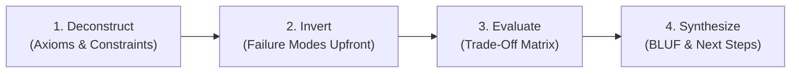

# Core Thinking Skill

## 1. Purpose & Philosophy
Provide a structured, first-principles cognitive framework for technical and strategic decision-making. Reject reasoning by analogy and superficial consensus; deconstruct problems to foundational truths, surface critical trade-offs, anticipate failure modes upfront, and communicate with executive brevity.

---

## 2. Core Pillars

### A. First-Principles Decomposition
* **Strip Analogies**: Separate verified physical or computational truths from convention, tradition, and borrowed assumptions.
* **Identify Invariants**: State non-negotiable constraints (e.g., CAP theorem limits, cost caps, latency budgets).
* **Question Base Assumptions**: Actively challenge hidden premises before exploring solution spaces.

### B. Failure Modes Upfront (Inversion & Pre-Mortem)
* **Assume Catastrophic Failure**: Prior to praising an approach, determine how it breaks under real-world pressure.
* **Blast Radius Analysis**: Quantify the impact of failure (data corruption, silent degradation, cascading outages).
* **Mitigation by Design**: Incorporate defensive boundaries, fallbacks, and circuit breakers into the proposal.

### C. Rigorous Trade-Off Matrix
* **No Free Lunch**: Every architectural or product choice sacrifices something (simplicity, velocity, cost, scale).
* **Two-Way vs. One-Way Doors**:
  * *Type 1 (Irreversible)*: High deliberation, exhaustive trade-off scrutiny, consensus verification.
  * *Type 2 (Reversible)*: Rapid experimentation, bias for action, lightweight validation.
* **Standard Evaluation Dimensions**:
  * Operational Complexity vs. Developer Velocity
  * Latency / Performance vs. Resource Cost
  * Extensibility vs. Immediate Delivery

### D. Concise Communication (BLUF)
* **Bottom-Line Up Front (BLUF)**: State the core finding, decision, or recommendation in the very first sentence.
* **Prose Economy**: Use structured bullets over rambling narrative; eliminate filler and conversational pleasantries.
* **Visible Deliberation**: Present clear options, explicit trade-offs, and reasoned conclusions.

---

## 3. Four-Step Thinking Workflow



1. **Deconstruct**: Isolate core variables, physical limits, and confirmed invariants. List unproven assumptions.
2. **Invert (Pre-Mortem)**: Detail top 3 failure vectors, edge-case vulnerabilities, and systemic risks.
3. **Evaluate Options**: Construct a comparative matrix evaluating 2–3 viable approaches against standard dimensions.
4. **Synthesize**: Deliver the recommendation using BLUF, stating rationale, residual risks, and next steps.

---

## 4. Deep References & Customization

* **Mental Models & Heuristics**: Consult [Mental Models](references/mental-models.md) for deep frameworks (Chesterton's Fence, Occam's Razor, Ashby's Law, Decision Trees).
* **Project Configuration**: See [Skill Overrides](overrides.md) to customize risk thresholds, evaluation dimensions, or output brevity.

---

# ============================================================
# PROGRESSIVE DISCLOSURE REFERENCES
# ============================================================

## Reference: references/mental-models.md

# Mental Models & Cognitive Heuristics

This reference document expands on the cognitive tools, frameworks, and mental models applied within the `core-thinking` skill.

---

## 1. Foundational Cognitive Frameworks

### 1.1 First-Principles Thinking
* **Core Idea**: Boil a problem down to the most fundamental, unquestionable truths and build an answer up from there, rather than reasoning by comparison to existing conventions.
* **How to Apply**:
  1. Identify current assumptions or conventional practices ("We need a distributed database because everyone uses Microservices").
  2. Ask: What physical, computational, or business laws dictate this?
  3. Strip away domain lore until reaching basic axioms (network latency limits, read/write ratios, consistency requirements).
  4. Synthesize a clean-sheet architecture matching actual axioms.

### 1.2 Inversion & Pre-Mortem Analysis
* **Core Idea**: Instead of asking "How do we succeed?", ask "How do we guarantee catastrophic failure, and how do we prevent it?" (Carl Jacobi / Charlie Munger).
* **Pre-Mortem Protocol**:
  1. Fast-forward to 12 months after deployment: *The project failed utterly.*
  2. Write down the post-mortem narrative detailing exactly what broke:
     - Did upstream APIs throttle us?
     - Did silent data corruption bypass monitoring?
     - Did developers circumvent the deployment process due to friction?
  3. Work backward to institute specific guardrails and circuit breakers today.

### 1.3 Second-Order Thinking & Chesterton's Fence
* **Second-Order Effects**: Always ask "And then what?". First-order effects are obvious, attractive, and immediate. Second-order effects are delayed, systemic, and often punitive.
* **Chesterton's Fence**: Never tear down a fence or delete a legacy routine until you understand why it was built in the first place.
  * Before refactoring or removing complex logic, discover what obscure edge case or historical failure prompted its creation.

### 1.4 Reversible vs. Irreversible Decisions (Type 1 vs. Type 2)
* **Type 1 (One-Way Doors)**: Irreversible or catastrophic to undo (e.g., choosing a primary storage engine, public API contracts, data partitioning keys).
  * *Policy*: High deliberation, deep failure mode analysis, architectural review records (ADRs), peer consensus.
* **Type 2 (Two-Way Doors)**: Easily reversible with minimal blast radius (e.g., internal interface naming, UI component styles, feature flag defaults).
  * *Policy*: Bias for action, rapid local iteration, minimal overhead. Do not treat Type 2 decisions with Type 1 bureaucratic weight.

### 1.5 Ashby's Law of Requisite Variety
* **Core Idea**: In cybernetics, for an agent/system to regulate another system, the variety of its internal control states must equal or exceed the variety of states in the system being managed.
* **Application in Software**: A monitoring system with 3 discrete error states cannot reliably manage a distributed system with 50 failure modes. Simplify the problem space or enrich control mechanisms.

### 1.6 Occam's Razor & Hanlon's Razor
* **Occam's Razor**: When presented with competing hypotheses that explain observations equally well, select the one with the fewest assumptions. Complexity is a liability.
* **Hanlon's Razor**: Never attribute to malice (or complex conspiracy) that which is adequately explained by neglect, miscommunication, or simple oversight.

---

## 2. Trade-Off Matrix Schema & Scoring Guide

When choosing among architectural options, construct an explicit evaluation matrix.

### Evaluation Template

| Evaluation Dimension | Option A: [Name] | Option B: [Name] | Option C: [Name] |
| :--- | :--- | :--- | :--- |
| **Architectural Simplicity** | High (Monolith / single process) | Moderate (Modular service) | Low (Distributed cluster) |
| **Operational Overhead** | Low (Single deployment target) | Medium (Container orchestrator) | High (Multi-region coordination) |
| **Latency / Throughput** | Sub-millisecond (in-memory) | 10–25ms network hop | 50ms+ distributed consensus |
| **Blast Radius of Failure** | Whole service crash | Single service boundary | Cascading partition risk |
| **Reversibility** | Type 2 (Reversible) | Type 2 (Reversible) | Type 1 (One-Way Door) |
| **Time to Market** | Immediate (Days) | Intermediate (Weeks) | Delayed (Months) |

### Scoring Heuristics
1. **Never use single-dimensional optimization**: Optimizing purely for throughput often sacrifices maintainability; optimizing purely for cost often destroys reliability.
2. **Surface Hidden Liabilities**: Highlight maintenance burden, operational pager fatigue, and vendor lock-in as explicit costs.
3. **Establish a Tie-Breaker Principle**: Declare in advance which attribute dominates (e.g., "Developer velocity dominates over raw latency for our current user scale").

---

## 3. Cognitive Biases & Mitigation Playbook

| Bias | Typical Failure Mode | Mitigation Protocol |
| :--- | :--- | :--- |
| **Confirmation Bias** | Gathering only evidence that supports a favored solution while ignoring contradictory data. | Appoint a designated "Devil's Advocate" or explicitly task an agent with finding 3 fatal flaws. |
| **Sunk Cost Fallacy** | Continuing to invest in a flawed design because significant engineering hours were already spent. | Evaluate the current state from a zero-base: "If we started today with what we know now, would we build this?" |
| **Availability Heuristic** | Recommending a tool or pattern simply because it was recently encountered or used in the last sprint. | Require architectural justification tied directly to project requirements, not familiarity. |
| **Survivorship Bias** | Copying big-tech architectures (Google/Netflix) without having their traffic scale, staff, or constraints. | Anchor analysis on current volume and realistic 18-month growth trajectories. |
| **Planning Fallacy** | Systematically underestimating integration friction, edge cases, and testing time. | Add explicit buffers and evaluate worst-case dependency delays during pre-mortem. |

---

## 4. Communication Architecture: Executive BLUF

1. **Sentence 1: The Verdict**:
   - *Example*: "Adopt Option A (PostgreSQL with JSONB indexing) for the user activity log; reject Option B (Elasticsearch cluster)."
2. **Bullets 2–4: Key Drivers**:
   - Matches current throughput needs (1,500 writes/sec) with zero operational infrastructure additions.
   - Eliminates distributed synchronization failure modes and dual-write consistency issues.
   - Saves ~$2,400/month in cloud hosting and maintenance overhead.
3. **Paragraph 2: Residual Risks & Safeguards**:
   - High data retention (>10M rows) requires table partitioning after 6 months. Mitigated by automated monthly pg_partman maintenance.

---

# ============================================================
# LOCAL CONFIGURATION OVERRIDES (overrides.md)
# ============================================================

# Core Thinking — Overrides & Configuration

This file provides project-level and user-specific configuration overrides for the `core-thinking` skill. Modify these settings to tune decision thresholds, rigor levels, and communication formats.

---

## 1. Decision Rigor Level

* **Default**: `Balanced`
* **Options**:
  * `Iterative` (Bias for action; minimal pre-mortem; fast prototypes; Type 2 focus)
  * `Balanced` (Standard first-principles analysis; 3 failure modes; trade-off matrix)
  * `Defensive` (Exhaustive pre-mortem; formal ADR requirements; Type 1 irreversible scrutiny)

```yaml
rigor_level: Balanced
```

---

## 2. Priority Dimension Weighting

Define which dimension takes precedence when evaluating trade-offs in this project:

```yaml
tradeoff_priorities:
  simplicity_over_optimization: true
  developer_velocity_over_raw_throughput: true
  open_standards_over_proprietary_features: true
  operational_resilience_over_feature_breadth: true
```

---

## 3. Communication Constraints

```yaml
communication:
  bluf_enforced: true
  max_recommendation_bullets: 4
  show_visible_tradeoffs: true
  suppress_conversational_filler: true
```

---

## 4. Domain Invariants & Hard Constraints

List absolute system invariants that all proposed solutions must respect (e.g., zero data loss, specific cloud providers, cost caps):

* Invariant 1: Any solution must support standard headless execution.
* Invariant 2: No introduction of external proprietary daemons or unapproved SaaS dependencies.
* Invariant 3: P99 latency SLA must remain under 200ms.
