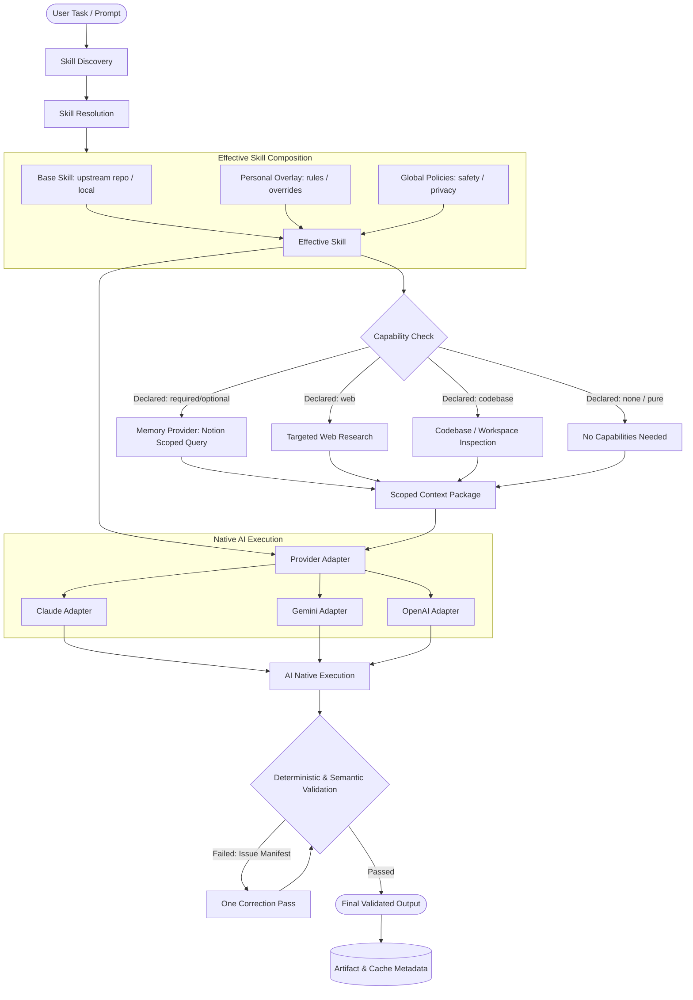

# Anchor Core — System Architecture

This document details the system architecture of **Anchor Core**, specifying the division of layers, execution pipeline, data boundaries, overlay composition mechanics, provider adapter isolation, and security tiers.

---

## 1. System Vision & The Three Primary Layers

Anchor Core decouples the three fundamental questions of modern AI assistance:

```
┌────────────────────────────────────────────────────────┐
│                   A. PERSONAL MEMORY                   │
│             "What is true about Bhargava?"             │
│            Storage: Notion (Personal Brain)            │
└───────────────────────────┬────────────────────────────┘
                            │ (loaded only on demand)
┌───────────────────────────▼────────────────────────────┐
│                    B. SKILL LAYER                      │
│        "How should this type of task be performed?"    │
│            Storage: Git Repository / GitHub            │
└───────────────────────────┬────────────────────────────┘
                            │ (packaged via adapters)
┌───────────────────────────▼────────────────────────────┐
│              C. IMPLEMENTATION / PROVIDER              │
│       "How does this environment execute the skill?"   │
│             Target: Claude, Gemini, OpenAI...          │
└────────────────────────────────────────────────────────┘
```

### Layer A: Personal Memory (Anchor-Brain)
* **Responsibility**: Maintains factual truth, history, preferences, skills, evidence, and privacy tiers.
* **Current Storage**: **Notion**.
* **Key Constraint**: Notion holds *meaning, evidence, and state*. It does **not** store Python/JS code, prompt boilerplate, PDF generation logic, or runtime adapters.

### Layer B: Skill Layer (Anchor Skills)
* **Responsibility**: Houses declarative instructions, input/output schemas, task workflows, validation criteria, and reference checklists.
* **Storage**: **Git repository (`skill-shelf` / `anchor-skills`)**.
* **Key Constraint**: Base skills are pure workflows. They know *how to solve a problem*, but do not hardcode personal candidate facts or provider-specific configuration.

### Layer C: Provider / Implementation Layer
* **Responsibility**: Translates universal skill instructions into the native discovery and execution formats of specific AI runtimes (e.g., Claude Code, Gemini Antigravity, OpenAI Codex).
* **Storage**: `adapters/` or `providers/` directories within the skill repository.
* **Key Constraint**: Provider differences (frontmatter conventions, tool calling schemas, directory layouts) are isolated in adapters. Universal skills remain 100% agnostic.

---

## 2. Central Execution Pipeline

The core execution path flows from user input through resolution, composition, capability injection, provider adaptation, execution, validation, and caching:



---

## 3. Capability Resolution & Scoped Memory

Memory is an **optional capability**, never an ambient background stream. Ambient memory wastes token windows, introduces irrelevant noise, and violates data privacy.

### Skill Capability Declarations
Each skill must explicitly declare its capability requirements in its metadata:

```yaml
capabilities:
  memory: optional    # forbidden | optional | required
  web: optional       # forbidden | optional | required
  codebase: forbidden # forbidden | optional | required
```

### Scoped Context Requests
When memory is required or permitted, the skill requests specific scopes. It never asks for "everything about the user":

```yaml
memory_scopes:
  - identity.education
  - experience.backend
  - projects.relevant
  - style.communication
```

This enforces the **principle of least privilege**: a resume skill sees backend projects and education, but never financial notes, private personal journals, or irrelevant hobbies.

---

## 4. Skill Classes: Pure vs. Personalized

Anchor Core categorizes all skills into distinct classes to prevent unnecessary memory or tool coupling:

| Skill Class | Definition | Capabilities Required | Example |
| :--- | :--- | :--- | :--- |
| **Pure Skill** | Operates strictly on direct inputs. Deterministic transformation. | None (No memory, no web) | JSON Formatter, Markdown Table Sanitizer |
| **Environment Skill** | Interacts with the local execution environment or repository. | Codebase, Git, Tests, Terminal | Code Review, Git Conflict Resolver |
| **Personalized Skill** | Requires candidate memory, evidence, or specific personal voice. | Scoped Memory, Candidate Evidence | Resume Generator, LinkedIn Bio Creator |
| **Composite Skill** | Orchestrates multiple capabilities across web, memory, and code. | Scoped Memory, Web, Workspace | Hackathon Opportunity Evaluator |

---

## 5. External Skill Reuse & Base + Overlay Model

Anchor Core avoids duplicating external skill repositories (such as `obra/superpowers`). When an external skill already implements a high-quality workflow (e.g., TDD, systematic debugging), it is treated as an upstream dependency.

```
Upstream Base Skill (e.g. superpowers/systematic-debugging)
             │
             ▼
   Personal Overlay (Anchor additions / restrictions)
             │
             ▼
      Effective Skill (Combined workflow executed by AI)
```

### Overlay Operations
Personal customization is expressed through deterministic operations, avoiding AI-driven semantic conflict guessing:

1. **ADD**: Injects additional steps, evidence requirements, or constraints.
   * *Example*: Add a requirement to "explain the root cause before editing code."
2. **REPLACE**: Overrides a specific step or default behavior with a user-preferred method.
   * *Example*: Replace default npm test runner with pnpm or custom runner.
3. **RESTRICT**: Forbids certain actions or outputs.
   * *Example*: "Do not auto-commit without explicit manual review."
4. **PRIORITISE**: Adjusts the evaluation order or section hierarchy.
   * *Example*: Prioritize backend system design experience over frontend tasks.

### Conflict Resolution Hierarchy
When instructions or rules appear contradictory, the system applies a strict precedence chain:

$$\text{Global Safety / Security} > \text{User Hard Constraints} > \text{Provider Capability Limits} > \text{Base Skill Defaults}$$

If a conflict cannot be resolved deterministically by this hierarchy, the system must **raise an issue flag** rather than silently hallucinate a compromise.

---

## 6. Provider Adapter Model

Universal skill definitions must remain completely insulated from vendor-specific configuration. 

```
                       Universal Skill (SKILL.md)
                                   │
                           Provider Adapter
                                   │
              ┌────────────────────┼────────────────────┐
              ▼                    ▼                    ▼
       Claude Adapter        Gemini Adapter       OpenAI Adapter
      (.claude/skills)      (.gemini/skills)     (custom assistant)
```

Each adapter is responsible for:
* Translating directory structure and file placement.
* Mapping frontmatter schemas (`name`, `description`, `tags`).
* Mapping tool and hook declarations.
* Declaring provider-specific permissions and sandboxing.

### Provider Research Discipline
When building or updating adapters, never assume providers behave identically. Engineers must follow the 12-step research rule:
1. Review official provider documentation.
2. Inspect official reference examples.
3. Verify directory discovery logic (e.g., `.agents/skills`, `.gemini/antigravity-ide/builtin/skills`, Claude Code plugins).
4. Inspect frontmatter syntax.
5. Record activation triggers and keyword sensitivities.
6. Check available built-in tools.
7. Verify hook and event models.
8. Document permission and execution boundaries.
9. Note limitations (context limits, timeout behaviors).
10. Test installation and uninstallation behaviors.
11. Build the adapter strictly around verified facts.
12. Never invent unverified provider capabilities.

---

## 7. Security and Encapsulation Tiers (L0–L4)

To protect sensitive information, personal memory is partitioned into visibility tiers:

| Tier | Classification | Definition & Usage Rules |
| :---: | :--- | :--- |
| **L0** | **Public** | Information already public (GitHub bio, public talks, open-source repositories). Can be included in any external output. |
| **L1** | **Professional** | Standard career and professional data (resumes, verified experience, public portfolio). Suitable for recruitment and networking. |
| **L2** | **Private** | Personal preferences, internal working notes, private project ideas. Accessible only for internal reasoning tasks; cannot be published without explicit confirmation. |
| **L3** | **Restricted** | Confidential work, NDAs, compensation history, sensitive personal details. Requires explicit task-level authorization; never exposed in generated drafts. |
| **L4** | **Retired / False** | Deprecated skills, abandoned projects, superseded contact info, refuted assumptions. **Strictly barred from being used as current evidence.** |

> [!CAUTION]
> Prompt instructions alone are not security boundaries. Visibility checks must be handled at the scoped retrieval layer before memory content enters the AI context window.

---

## 8. Artifact, Cache, and Memoisation Model

Expensive operations (such as multi-step JD extraction, company analysis, or complex document layout) should not be repeated unnecessarily. 

Anchor Core defines an artifact metadata schema for caching:
* `artifact_id`: Unique identifier of the generated artifact.
* `input_hash`: Cryptographic hash of input parameters (JD, candidate facts, user options).
* `memory_version`: Timestamp or commit hash of the personal memory snapshot.
* `skill_version`: Version of the base skill and overlay.
* `template_version`: Version of the layout and typography configuration.
* `validation_status`: Verification outcome (PASSED / FAILED).
* `output_path`: Stored location of generated files (e.g., PDF, markdown).

If the input hash, memory version, and skill version match a previous run, the system reuses existing work instead of running redundant LLM passes.

---

## 9. Emergency Medpack (Degraded Fallback)

Anchor Core is engineered to provide resilience when full development infrastructure is unavailable (e.g., mobile device, offline environment, broken dependencies):

* **Minimal footprint**: Operates with zero external package dependencies.
* **No durable state modification**: Does not write back to Notion or alter Git repositories.
* **Degraded mode**: Produces clean plain-text or Markdown drafts when PDF rendering engines cannot run.
* **Explicit assumption logging**: Clearly states all missing evidence or unverified assumptions in an audit block, enabling full desktop reconciliation later.
