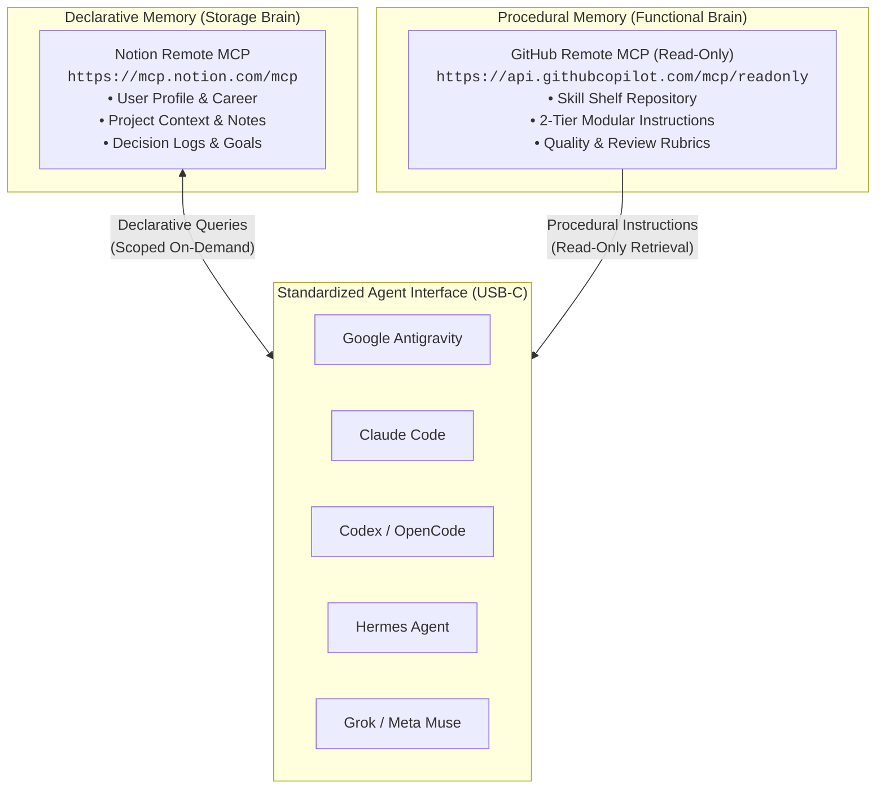
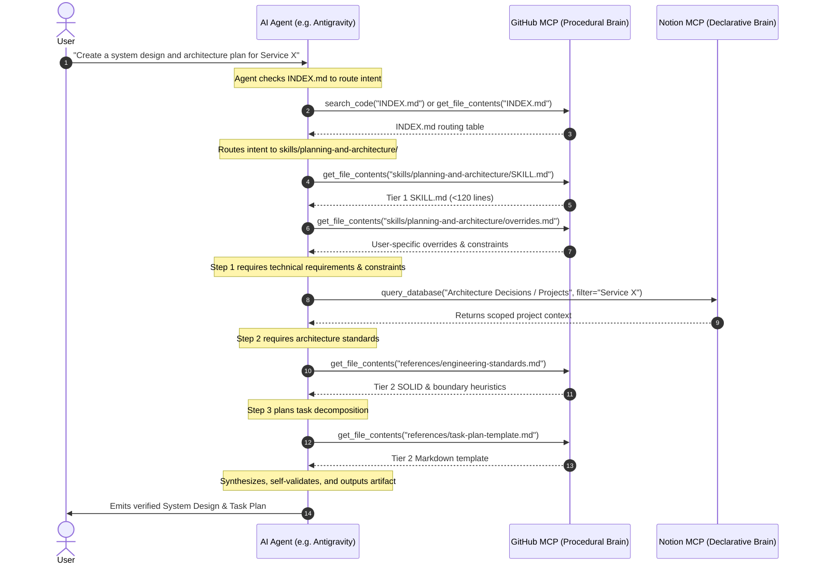

# Skill Shelf — System Architecture

This document articulates the architecture of **Skill Shelf**, defining the **Dual-Brain "USB-C" Model**, the **Remote HTTP MCP Zero-Server Model**, and the **2-Tier Progressive Disclosure Engine** that powers provider-independent AI agent execution.

---

## 1. System Vision: The Dual-Brain "USB-C" Model

Modern AI workflows require two fundamentally different types of memory:
1. **Declarative Memory ("What is true")**: Personal facts, career history, preferences, project states, and business notes.
2. **Procedural Memory ("How to act")**: Step-by-step algorithms, cognitive models, engineering rubrics, validation gates, and quality checklists.

Conflating these two leads to messy context windows, proprietary lock-in, and fragile prompt bloat. **Skill Shelf** solves this with the **Dual-Brain "USB-C" Model**: an open, modular architecture where any AI agent plugs into two standardized sockets.



### The Two Brains Decoupled

| Dimension | Declarative Memory (Storage Brain) | Procedural Memory (Functional Brain) |
| :--- | :--- | :--- |
| **System** | **Notion** | **GitHub (`skill-shelf`)** |
| **Endpoint** | `https://mcp.notion.com/mcp` | `https://api.githubcopilot.com/mcp/readonly` |
| **Question Answered**| *"What is true about the user, project, or context?"* | *"How should this cognitive or engineering task be executed?"* |
| **Content Type** | Dynamic state, biography, requirements, project notes. | Version-controlled, immutable markdown workflows, rubrics. |
| **Access Mode** | Read / Write (User-authenticated, scoped queries). | Strictly Read-Only (`get_file_contents`, `search_code`). |
| **Lifespan** | Evolves with user history and project progress. | Versioned with Git tags, PRs, and CI validation. |

---

## 2. Remote HTTP MCP Zero-Server Model

Traditional Model Context Protocol (MCP) implementations rely on local subprocesses: Node.js scripts, Python daemons, or Docker containers running on the user's host machine. This creates severe operational pain:
* Dependency conflicts (`node_modules`, Python virtual environments).
* Daemon crashes, zombie background processes, and memory leaks.
* Port collisions and OS-specific setup hurdles between Windows, macOS, and Linux.

**Skill Shelf** adopts the **Remote HTTP MCP Zero-Server Model**:

```text
┌────────────────────────────────────────────────────────┐
│                   AGENT ENVIRONMENT                    │
│   (Google Antigravity / Claude Code / Codex / Hermes)  │
└───────────────────────────┬────────────────────────────┘
                            │ Outbound HTTPS / SSE
             ┌──────────────┴──────────────┐
             ▼                             ▼
┌──────────────────────────┐  ┌──────────────────────────┐
│        NOTION MCP        │  │    GITHUB COPILOT MCP    │
│  https://mcp.notion.com  │  │ api.githubcopilot.com    │
│           /mcp           │  │       /mcp/readonly      │
│  (Declarative Memory)    │  │   (Procedural Memory)    │
└──────────────────────────┘  └──────────────────────────┘
```

### Architectural Guarantees of the Zero-Server Model
1. **Zero Host Daemons**: No background processes or open ports on the client device.
2. **Standardized HTTPS/SSE**: Connections run over secure standard HTTPS using Server-Sent Events (SSE).
3. **Provider Portability**: Any agent runtime supporting remote HTTP MCP can connect immediately using copy-paste JSON or YAML configurations.
4. **Instant Synchronization**: Updates pushed to GitHub are immediately accessible to all connected agents without needing to rebuild or restart local servers.

---

## 3. 2-Tier Progressive Disclosure Architecture

Large Language Models perform poorly when overwhelmed with massive, monolithic instructions (>1,000 lines). Prompt bloat degrades reasoning, increases token consumption, and invites hallucination.

Skill Shelf enforces a strict **2-Tier Progressive Disclosure Architecture**:

```text
skills/planning-and-architecture/
├── SKILL.md                 # TIER 1: Master Workflow (<120 lines)
│                            #   • Frontmatter (name, trigger-rich description <= 1024 chars)
│                            #   • I/O Contract & Prerequisites
│                            #   • Step-by-Step Execution Sequence
│                            #   • Pointers to Tier 2 references
│
├── overrides.md             # LOCAL EXTENSION: Base + Overrides Layer
│                            #   • Personal constraints, tool choices, style rules
│
└── references/              # TIER 2: Deep Heuristics (Loaded strictly on-demand)
    ├── engineering-standards.md
    └── task-plan-template.md
```

### Tier 1: The Fast-Discovery Index (`SKILL.md`)
* **Strict Constraint**: Under 120 lines (validated via CI).
* **Role**: Defines the operational contract:
  * Frontmatter adhering to the `agentskills.io` standard.
  * Trigger keywords matching user intent.
  * Inputs required and concrete deliverables produced.
  * High-level phased execution steps (Phase 1 $\rightarrow$ Phase 2 $\rightarrow$ Phase 3).
  * Direct relative links to Tier 2 files when a step demands deep knowledge.

### Tier 2: Modular Deep Heuristics (`references/*.md`)
* **Role**: In-depth checklists, mental model taxonomies, validation rubrics, and templates.
* **Loading Rule**: **Never loaded proactively.** An agent reads a Tier 2 reference only when it enters the specific step requiring those details.
* **Benefit**: When an agent performs task planning, it only loads `references/task-plan-template.md`. It never pollutes its context with debugging checklists or code review red-flag tables.

### Overrides Layer: Personal Customization (`overrides.md`)
* Located at the root of every skill folder.
* Allows users and teams to apply local constraints (`ADD`, `REPLACE`, `RESTRICT`, `PRIORITISE`) without modifying the upstream base skill.

---

## 4. End-to-End System Execution Flow

The following sequence illustrates how an agent uses the Dual-Brain architecture to execute a user request:



---

## 5. Security & Read-Only Boundaries

Skill Shelf enforces defensive boundaries to protect both code and user data:

1. **Procedural Immutability**:
   * The GitHub connection runs through `https://api.githubcopilot.com/mcp/readonly`.
   * Agents are constrained by an `enabledTools` allowlist (`get_file_contents`, `search_code`).
   * Agents are physically prevented from pushing commits, modifying skill definitions on the fly, or executing arbitrary shell scripts inside the functional brain.
2. **Least Privilege Declarative Retrieval**:
   * Declarative memory is not dumped as ambient context.
   * Agents issue targeted, scoped queries to Notion databases based strictly on the active task.
   * Private personal journals or unrelated sensitive notes are never exposed to public or engineering skill executions.
3. **Zero Secrets in Repository**:
   * The repository contains no API keys, personal bios, or bearer tokens.
   * All authentication tokens are supplied at the client agent layer via environment variables or secret vaults.

---

## 6. Repository Layout & Organization

The repository structure reflects the architecture:

```text
skill-shelf/
├── INDEX.md                     # Master routing table (intent -> skill path)
├── AGENTS.md                    # Universal repo rules (agentskills.io, <120 lines, overrides)
├── README.md                    # Dual-Brain overview, quickstart & USB-C model
│
├── docs/                        # Architectural & Operational Documentation
│   ├── architecture.md          # This document (Dual-Brain, 2-Tier, Zero-Server)
│   ├── design_principles.md     # OOP, SOLID, context hygiene, allowlists, overrides
│   ├── agent_connection_guide.md# Copy-paste configs (Antigravity, Claude, Codex, Hermes, Grok)
│   └── roadmap.md               # 3-Phase evolution roadmap
│
├── skills/                      # Canonical Skills Library
│   ├── core-thinking/           # First-principles decomposition & mental models
│   ├── brainstorm-and-validate/ # 4-step wedge discovery & validation rubric
│   ├── planning-and-architecture/# System design, SOLID, ADRs & task plans
│   ├── systematic-debugging/    # 4-phase root-cause tracing & regression proof
│   ├── code-review/             # Subagent diff review & severity triage
│   └── english-writing/         # Reusable language capability (preserved)
│
├── scripts/                     # Automation & Tooling
│   ├── validate_skills.py       # Validates frontmatter, <120 lines, links & overrides
│   ├── bundle_skills.py         # Flattens skills into dist/ for chat-only interfaces
│   ├── sync.ps1                 # Windows PowerShell native symlink/copy tool
│   └── sync.sh                  # POSIX bash equivalent
│
└── dist/                        # Bundled standalone skills for chat-only agents
```
