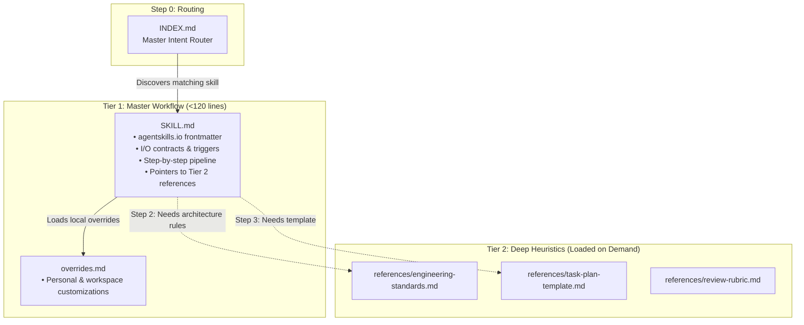
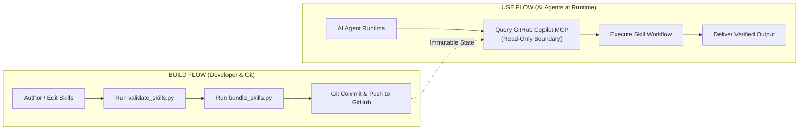

# Skill Shelf — Design Principles & Instruction Architecture

This document articulates the engineering principles governing **Skill Shelf**. By treating prompt engineering as software architecture, we apply classical **Object-Oriented Programming (OOP), SOLID, and DRY principles** to instruction sets, documentation, and agent workflows.

---

## 1. 2-Tier Progressive Disclosure

### The Context Window Bottleneck
Large Language Models (LLMs) operate under finite context budgets. Monolithic prompts (>1,000 lines) degrade model performance in three distinct ways:
1. **Lost in the Middle**: Crucial instructions placed in the middle of long prompts are frequently ignored.
2. **Instruction Drift & Hallucination**: Distracting heuristics cause the model to jump ahead, misinterpret constraints, or invent facts.
3. **Token Inefficiency**: Loading an entire library of rules on every turn burns tokens and degrades latency.

### The 2-Tier Solution
Skill Shelf decomposes knowledge into two strictly bounded tiers:



* **Tier 1 (`SKILL.md`)**:
  * Must remain strictly **under 120 lines** (enforced by `scripts/validate_skills.py`).
  * Acts as the algorithmic orchestrator: specifies triggers, prerequisites, inputs, outputs, phase transitions, and relative links to Tier 2 references.
* **Tier 2 (`references/*.md`)**:
  * Modular deep-dives: detailed checklists, mental model taxonomies, validation rubrics, syntax guides, and templates.
  * **Rule**: Tier 2 references are **never loaded upfront**. The agent fetches a reference file via MCP only when executing the specific step that requires it.

---

## 2. Context Hygiene & Anti-Vibe-Coding Rules

Prompt instructions must be engineered with the same precision as systems software. Vague, conversational prose degrades model determinism.

### Core Rules for Context Hygiene
1. **Zero Fluff & Cheerleading**:
   * Prohibited: *"You are an elite, world-class software architect! Strive for utmost perfection and be awesome."*
   * Required: *"Analyze the system architecture against SOLID principles. Verify that controllers are thin and business logic is isolated in domain services."*
2. **The "What Breaks?" Test**:
   * For every rule, sentence, or constraint added to a skill, ask: **"What specific failure occurs in the AI output if this line is deleted?"**
   * If removing the line does not measurably increase output defects, delete it immediately.
3. **Concrete Formulas Over Vague Directives**:
   * Prohibited: *"Make the code clean and well-structured."*
   * Required: *"Limit function length to under 30 lines. Enforce Single Responsibility: each class must have one reason to change."*
4. **Issue Manifest Before Execution**:
   * Complex workflows (such as debugging or code review) require the agent to generate an explicit **Issue Manifest** or **Triage Table** before suggesting code modifications.
   * Prevents premature fixes and unverified guessing.

---

## 3. `enabledTools` Allowlists & Least Privilege

Connecting an AI agent to an external tool repository introduces security and stability risks if the tool surface is unrestricted.

```text
┌────────────────────────────────────────────────────────┐
│                   AI AGENT RUNTIME                     │
└───────────────────────────┬────────────────────────────┘
                            │
               Restricted by enabledTools:
               ["get_file_contents", "search_code"]
                            │
                            ▼
┌────────────────────────────────────────────────────────┐
│              GITHUB COPILOT READ-ONLY MCP              │
│       https://api.githubcopilot.com/mcp/readonly       │
├────────────────────────────────────────────────────────┤
│  ALLOWED:                                              │
│  ✔ Read INDEX.md & AGENTS.md                           │
│  ✔ Read skills/<name>/SKILL.md                         │
│  ✔ Read skills/<name>/references/*.md                  │
│  ✔ Search repository files by symbol or path           │
│                                                        │
│  FORBIDDEN & BLOCKED:                                  │
│  ✖ Write, edit, or commit files                        │
│  ✖ Execute shell commands or scripts                   │
│  ✖ Delete repository assets                            │
│  ✖ Access environment variables or local secrets       │
└────────────────────────────────────────────────────────┘
```

### Architectural Rationale
* **Principle of Least Privilege**: An agent consuming skills only needs to discover and read markdown files. Granting write permissions or terminal execution to a remote procedural brain creates an unnecessary attack surface.
* **Prompt Injection Defense**: By restricting tool access strictly to `get_file_contents` and `search_code`, malicious prompts cannot instruct the agent to tamper with skill definitions or overwrite local files.
* **Deterministic Execution**: Agents operate as pure consumers of the procedural brain, guaranteeing that the skill instructions remain identical across all executions.

---

## 4. Base + Overrides Pattern (`overrides.md`)

Upstream base skills must remain pure, universal, and reusable across multiple users and teams. However, individual developers require customized preferences, stricter constraints, or project-specific tooling.

Skill Shelf resolves this via the **Base + Overrides Pattern**:
Every skill folder contains an `overrides.md` file at its root.

```text
skills/systematic-debugging/
├── SKILL.md            # Universal base skill (upstream, pristine)
├── overrides.md        # Local customizations & personal preferences
└── references/         # Universal checklists & taxonomies
```

### The Four Deterministic Override Primitives

When authoring `overrides.md`, use these four standardized verbs:

```markdown
# Local Overrides: Systematic Debugging

### ADD
- Prioritize reproducing bugs inside Docker container environments before checking host setups.
- Append a memory leak check step when debugging Node.js or Go services.

### REPLACE
- Replace default curl network diagnostics with `httpie` commands.
- Use Vitest instead of Jest for all unit test verification.

### RESTRICT
- Do NOT apply code modifications without an approved reproduction test case.
- Never modify database migration files that have already landed in production.

### PRIORITISE
- Prioritize backward API compatibility over architectural refactoring.
- Elevate type-safety constraints above runtime micro-optimizations.
```

### Conflict Resolution Precedence
When an agent executes a workflow, conflicts are resolved in this deterministic order:

$$\text{Global Safety / Security} > \text{Workspace / User } \texttt{overrides.md} > \text{Base } \texttt{SKILL.md} \text{ Defaults}$$

---

## 5. Read-Only Boundaries & Separation of Flows

Skill Shelf enforces a strict distinction between how skills are authored and how skills are consumed:



### Guarantees of the Read-Only Boundary
* **No Runtime Mutation**: Agents cannot modify their own skill instructions during execution.
* **Reproducibility**: Two different agents invoking the same skill at the same commit hash receive identical instructions.
* **Zero Contamination**: Errors or hallucinations produced during a specific task execution cannot contaminate the canonical skill library.

---

## 6. SOLID & DRY Applied to Prompt & Skill Engineering

Instruction sets suffer from the same entropy as application code. Skill Shelf directly implements the SOLID and DRY principles:

### S — Single Responsibility Principle (SRP)
* Each skill has **one** clear purpose:
  * `core-thinking`: First-principles decomposition and trade-off analysis.
  * `systematic-debugging`: Root-cause tracing and bug reproduction.
  * `planning-and-architecture`: System design and task planning.
  * `code-review`: Subagent diff review and severity triage.
  * `english-writing`: Reusable language and prose quality.
* Supporting files (`references/`) own narrow knowledge slices (e.g. `engineering-standards.md` owns SOLID rules; it does not dictate debugging protocols).

### O — Open/Closed Principle (OCP)
* Skills are **open for extension** (via `overrides.md`), but **closed for modification** (the base `SKILL.md` remains untouched).
* New project requirements do not require fork-bombing or rewriting upstream skills.

### L — Liskov Substitution Principle (LSP)
* Sub-skills and references are interchangeable if they satisfy the declared input/output contract.
* Any writing engine satisfying the language quality contract can replace `english-writing` without breaking consumer skills.

### I — Interface Segregation Principle (ISP)
* Skills expose lean, decoupled contracts. An agent only reads the reference files it actually needs for its current step.
* A pure code review task does not load prose composition rules; a resume planning task does not load root-cause checklists.

### D — Dependency Inversion Principle (DIP)
* High-level skill instructions depend on abstract capability contracts, not concrete agent-specific tooling.
* A skill declares: *"Retrieve file contents using the available read tool"*, rather than hardcoding vendor-specific syntax like `"call antigravity_tool_xyz"`.

### DRY — Don't Repeat Yourself
* Cross-cutting heuristics are defined in exactly one place:
  * English linguistic rules $\rightarrow$ `skills/english-writing/`
  * Engineering boundaries $\rightarrow$ `skills/planning-and-architecture/references/engineering-standards.md`
  * Root cause checklist $\rightarrow$ `skills/systematic-debugging/references/root-cause-checklist.md`
* Domain workflows link to these shared references rather than duplicating them.
