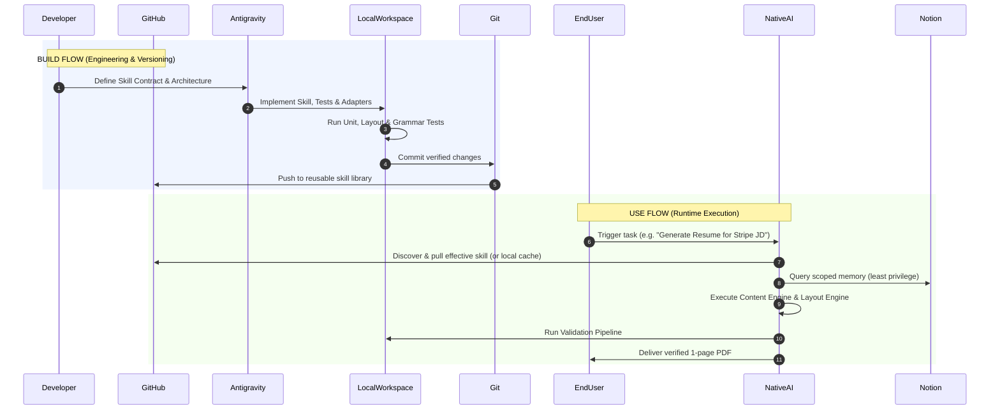

# Anchor Core — Design Principles & Engineering Philosophy

This document articulates the object-oriented design patterns, architectural paradigms, engineering standards, and anti-vibe-coding disciplines that govern **Anchor Core**.

---

## 1. Object-Oriented Mental Model

Anchor Core applies classical Object-Oriented Programming (OOP) and SOLID design principles to AI workflows:

```
┌────────────────────────────────────────────────────────┐
│                      ABSTRACTION                       │
│    Define WHAT a component does without leaking HOW    │
└───────────────────────────┬────────────────────────────┘
┌───────────────────────────▼────────────────────────────┐
│                     ENCAPSULATION                      │
│     Restrict internal access; leak only scoped data    │
└───────────────────────────┬────────────────────────────┘
┌───────────────────────────▼────────────────────────────┐
│                      COMPOSITION                       │
│        Assemble capabilities from decoupled units       │
└───────────────────────────┬────────────────────────────┘
┌───────────────────────────▼────────────────────────────┐
│                      POLYMORPHISM                      │
│       Multiple interchangeable concrete providers       │
└───────────────────────────┬────────────────────────────┘
┌───────────────────────────▼────────────────────────────┐
│                  DEPENDENCY INVERSION                  │
│       High-level workflows depend on interfaces         │
└────────────────────────────────────────────────────────┘
```

### 1.1 Abstraction
Define clean conceptual contracts that isolate callers from implementation changes:
* `Skill`: Defines a workflow interface (`inputs`, `outputs`, `workflow`, `capabilities`).
* `MemoryProvider`: Defines memory query interfaces without exposing whether storage is Notion, SQLite, or local markdown files.
* `PDFRenderer`: Defines `render(document, config) -> bytes`, abstracting the underlying graphics library.
* `Validator`: Defines `validate(target, rules) -> ValidationResult`.

### 1.2 Encapsulation
Internal state and irrelevant context are strictly hidden:
* A Resume Skill requests specific scopes (`experience.backend`, `projects.relevant`).
* The Memory Provider encapsulates raw Notion page schemas, properties, and internal identifiers, returning clean domain objects.
* Personal visibility tiers (L0–L4) are enforced at the provider boundary.

### 1.3 Composition
Complex behaviors are built by assembling independent, reusable components rather than creating monolithic, deep inheritance hierarchies:

$$\text{Effective Skill} = \text{Base Skill} + \text{Personal Overlay} + \text{Applicable Policies} + \text{Declared Capabilities}$$

### 1.4 Polymorphism
Interchangeable implementations satisfy the same contract:
```text
PDFRenderer (Interface)
├── ReportLabRenderer     (Python PDF rendering)
├── NodePDFRenderer       (Puppeteer / Chromium rendering)
└── TypstRenderer         (Typst modern markup rendering)
```
The caller (`ResumeGenerator`) invokes `render(document)` without knowing which engine executes the rasterization.

### 1.5 Dependency Inversion Principle (DIP)
High-level modules must never depend directly on low-level libraries or external APIs:
* **Correct**: `ResumeGenerator` $\rightarrow$ `PDFRenderer` interface $\leftarrow$ `ReportLabRenderer`
* **Incorrect**: `ResumeGenerator` $\rightarrow$ `reportlab.platypus` directly
* **Correct**: `ResumeSkill` $\rightarrow$ `MemoryProvider` interface $\leftarrow$ `NotionMemoryAdapter`
* **Incorrect**: `ResumeSkill` $\rightarrow$ Notion REST API directly

---

## 2. Engineering Philosophy: What to Embrace and What to Avoid

| Practice | Principle in Anchor Core |
| :--- | :--- |
| **High Cohesion, Loose Coupling** | Each module has one distinct reason to change (e.g. Layout calculations vs. Text generation). |
| **Separation of Concerns** | Content engines decide *what* to say; Layout engines decide *where* to place it. |
| **DRY (Don't Repeat Yourself)** | Visual constants, font families, margins, and column widths live in a single configuration file (`config/resume.yaml`), never duplicated across scripts. |
| **Deterministic Validation** | Use mechanical, programmatic checks (page count, margin overflow, extractable text) before relying on semantic LLM evaluation. |
| **Explicit Contracts** | Every skill defines strict input schemas, capability requirements, and expected outputs in its `SKILL.md`. |
| **No "AI Magic"** | If a problem can be solved with deterministic logic (e.g., word count estimation, layout coordinates, schema validation), do not waste tokens or risk hallucination by using an LLM. |
| **No Premature Frameworks** | Build only what is needed to satisfy the current phase milestone. Avoid building universal runtime daemons or microservices until real demand exists. |

---

## 3. Anti-Vibe-Coding Rules

Anchor Core prioritizes structural clarity and software engineering discipline over unstructured prompt generation and uninspected code output.

1. **Architectural Intent**: Never write code without first clarifying what problem it solves, which layer it belongs to, and what contract it satisfies.
2. **Component Justification**: Every class, function, or configuration key must have a clear answer to: *"What breaks if this is deleted?"*
3. **No Blind Acceptance**: All generated code must be reviewed, tested with real inputs, and verified against edge cases.
4. **Transparent Trade-offs**: When multiple implementations exist, document why one was selected over alternatives (e.g., ReportLab vs. Weasyprint vs. Puppeteer).

---

## 4. The 10 Learning Questions

For every component or module implemented in the repository, the following learning matrix must be answered in documentation:

```text
1. What is this?
2. Why does it exist?
3. What problem does it solve?
4. What is the interface?
5. What is the implementation?
6. What is provider-specific?
7. What can change later?
8. What assumptions exist?
9. What can fail?
10. How was it tested?
```

This ensures that the repository serves as a permanent, high-value learning asset for modern AI systems engineering.

---

## 5. Scope Discipline Matrix

During development, any proposed feature or improvement must be classified into one of four buckets:

```
┌─────────────────┬────────────────────────────────────────────┐
│ Classification  │ Action                                     │
├─────────────────┼────────────────────────────────────────────┤
│ NOW             │ Required to prove the current phase.       │
│ LATER           │ Documented in roadmap; deferred.           │
│ OPTIONAL        │ Nice-to-have; skipped unless trivial.      │
│ UNNECESSARY     │ Out of scope / architectural creep; reject.│
└─────────────────┴────────────────────────────────────────────┘
```

This prevents feature creep and ensures that each vertical slice reaches a production-grade Definition of Done before the next begins.

---

## 6. Build Flow vs. Use Flow

Anchor Core establishes a clean separation between how skills are authored and how skills are executed:



* **Build Flow**: The developer uses Antigravity IDE to design contracts, write modular components, run tests, and publish to GitHub.
* **Use Flow**: The end-user executes the skill within their native AI environment of choice (Claude, Gemini, OpenAI). Antigravity is **not** an always-running runtime intermediary.

---

## 7. The 18 Cardinal Anchor Rules

1. **Memory is optional** — default to zero ambient memory.
2. **Notion is the personal-memory store**, not an implementation repository.
3. **GitHub is the reusable skill source**, not a private memory vault.
4. **External skills must be reused as dependencies**, never copied or forked carelessly.
5. **Personal customization must be an overlay**, preserving pristine upstream baselines.
6. **Provider-specific behavior belongs in adapters**, keeping universal skills clean.
7. **Implementations must remain replaceable** behind stable abstraction interfaces.
8. **Skills must explicitly declare their dependencies and required capabilities**.
9. **Validation is strictly decoupled from generation**.
10. **Security is an architectural boundary (L0–L4)**, never a prompt-level suggestion.
11. **Do not fabricate personal information** — unverified claims are strictly forbidden.
12. **Use the minimum required context** (least privilege).
13. **Perform one complete analysis before correction** — eliminate multi-turn regeneration churn.
14. **Avoid repeated semantic regeneration** — favor deterministic logic.
15. **Do not build a universal runtime prematurely**.
16. **Do not over-engineer Phase 1** — prove the architecture with a focused vertical slice.
17. **Understand every component implemented** — anti-vibe-coding is mandatory.
18. **Research provider behavior from official docs**, never rely on assumptions.
