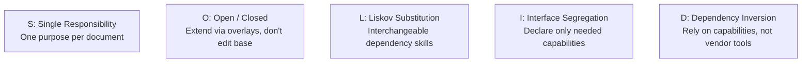

# Anchor Skills — Design Principles & Instruction Architecture

This document articulates how classical **Object-Oriented Programming (OOP), SOLID, and DRY principles** are applied to organize **skill instructions, documentation, and prompt workflows**—rather than software application code.

---

## 1. OOP Mental Model for Instruction Organization

When managing dozens of AI skills across multiple domains, unstructured prompt writing leads to context pollution, conflicting directives, and unmaintainable prompt bloat. Anchor Skills treats instruction sets as modular, engineered components:

```text
┌────────────────────────────────────────────────────────┐
│                      ABSTRACTION                       │
│      SKILL.md defines WHAT to do and the workflow      │
│      without cluttering the file with deep heuristics  │
└───────────────────────────┬────────────────────────────┘
┌───────────────────────────▼────────────────────────────┐
│                     ENCAPSULATION                      │
│     Self-contained skill folders; deep rules hidden    │
│     in references/; scoped memory requests only        │
└───────────────────────────┬────────────────────────────┘
┌───────────────────────────▼────────────────────────────┐
│                      COMPOSITION                       │
│       Assemble effective instructions: Base Skill      │
│       + Personal Overlay + Policies + Shared Links     │
└───────────────────────────┬────────────────────────────┘
┌───────────────────────────▼────────────────────────────┐
│                      POLYMORPHISM                      │
│      Identical skill instructions execute across       │
│      different AI runtimes (Claude, Gemini, OpenAI)   │
└───────────────────────────┬────────────────────────────┘
┌───────────────────────────▼────────────────────────────┐
│                  DEPENDENCY INVERSION                  │
│       Skills declare generic capabilities (web, memory)│
│       without hardcoding vendor APIs or concrete tools │
└────────────────────────────────────────────────────────┘
```

### 1.1 Abstraction
* **Definition**: A skill file defines the high-level workflow, triggers, inputs, and expected deliverables without embedding hundreds of lines of reference heuristics.
* **Instruction Practice**: `SKILL.md` outlines the 6-stage resume process (Analyze $\rightarrow$ Map $\rightarrow$ Draft $\rightarrow$ Layout $\rightarrow$ Validate $\rightarrow$ Output). It tells the AI: *"For term classification rules, read `references/jd-analysis.md`."* The workflow remains clean and comprehensible.

### 1.2 Encapsulation & Progressive Disclosure
* **Definition**: Information is strictly compartmentalized. Supporting knowledge is hidden until the AI actively needs it.
* **Instruction Practice**: 
  * A skill package encapsulates its domain knowledge inside `references/`.
  * Memory access is encapsulated into minimal scopes (`identity.education`, `experience.backend`). The skill never receives the user's entire personal history.

### 1.3 Composition
* **Definition**: Complex behaviors are formed by combining independent, reusable instruction blocks rather than writing monolithic super-prompts:

$$\text{Effective Skill} = \text{Base Skill} + \text{Personal Overlay} + \text{Shared Knowledge Pointers} + \text{Scoped Memory}$$

* **Instruction Practice**: Rather than duplicating coding principles inside every skill, the Resume Skill points to `shared/engineering/oop.md` when framing technical achievements.

### 1.4 Polymorphism & Portability
* **Definition**: The same skill package executes predictably across diverse AI environments without modifying the core instruction text.
* **Instruction Practice**: `skills/resume-generator/SKILL.md` is identical whether run by Claude, Gemini, or OpenAI. The provider's adapter handles discovery and tool invocation; the core instructions remain 100% portable.

### 1.5 Dependency Inversion Principle (DIP)
* **Definition**: High-level instructions must depend on abstract capabilities, never on vendor-specific implementations or tools.
* **Instruction Practice**:
  * **Correct**: The skill declares `capabilities: { memory: required, web: optional }`.
  * **Incorrect**: The skill hardcodes `"Make a curl call to the Notion API v2"` or `"Use Claude's bash tool"`.

---

## 2. SOLID Principles Applied to Prompt & Skill Engineering



### S — Single Responsibility Principle (SRP)
* **Rule**: Each document in the skill repository has exactly one reason to change.
* **Application**:
  * `SKILL.md`: Coordinates the workflow pipeline.
  * `references/jd-analysis.md`: Classifies job requirements (technical, responsibility, domain).
  * `references/grammar.md`: Enforces active voice, tense consistency, and parallel phrasing.
  * `references/layout.md`: Governs typography hierarchy, margins, and column geometry.
  * If formatting guidelines change, you update `references/layout.md`. `references/grammar.md` remains untouched.

### O — Open/Closed Principle (OCP)
* **Rule**: Skills are open for extension (via overlays and layout overrides) but closed for modification (upstream baselines remain untouched).
* **Application**: When adopting an upstream skill like `superpowers/systematic-debugging`, you do not edit the upstream file. You add an overlay with your personal rules (`ADD: explain root cause before proposing code`).

### L — Liskov Substitution Principle (LSP)
* **Rule**: A shared skill or external dependency can be substituted with another compatible skill without breaking the calling workflow.
* **Application**: If a skill depends on a shared `writing/grammar.md` standard, swapping it for an enhanced `writing/technical-style.md` standard preserves the calling skill's workflow integrity.

### I — Interface Segregation Principle (ISP)
* **Rule**: A skill should never be forced to declare, load, or depend on instructions it does not use.
* **Application**: A Pure Skill (like JSON Formatter) declares zero capabilities. It is not saddled with memory queries, web browsing rules, or personal identity context.

### D — Dependency Inversion Principle (DIP)
* **Rule**: High-level task workflows depend on capability declarations, leaving native AI environments to supply the concrete tools.
* **Application**: If a skill needs current company terminology, it declares `web: optional`. Whether Claude uses `web_search` or Gemini uses Google Search is transparent to the skill.

---

## 3. DRY (Don't Repeat Yourself) in Instruction Systems

Prompt duplication is a major source of instruction drift and maintenance failure.

* **Anti-Pattern**: Copying the same bullet formula (`Action + Tech + Metric`) into Resume, LinkedIn, Hackathon, and Portfolio skills. If you refine the formula, you have to find and edit 4 different files.
* **Anchor Solution**:
  * Store the standard in `shared/writing/active-voice.md`.
  * Skills reference the standard via pointer:
    > *"Draft accomplishment bullets following `shared/writing/active-voice.md`."*
  * Updates made in `shared/` immediately enhance every dependent skill.

---

## 4. Anti-Vibe-Coding Rules for Skill Authoring

Skills are engineering assets, not casual chat prompts. All instructions must adhere to the following standards:

1. **Delete Fluff**: Remove cheerleading language (*"You are a world-class resume genius"*, *"Make it amazing!"*). Modern models respond to clear constraints, input schemas, and deterministic rubrics.
2. **The "What Breaks?" Test**: For every rule or sentence in a skill, ask: *"What degrades in the AI's output if this line is deleted?"* If the answer is "nothing," delete it.
3. **Concrete Formulas Over Vague Directives**:
   * Instead of *"Write impactful bullets"*, specify:
     $$\text{Bullet} = \text{Past-Tense Action Verb} + \text{Technical Core / Tool} + \text{Quantified Impact / Scale}$$
   * Instead of *"Make it ATS friendly"*, specify:
     * Extractable vector text only (no image-rendered contact info).
     * Standard section headings (`Experience`, `Education`, `Skills`, `Projects`).
     * Zero unverified keyword fabrication.
4. **Determinism Over Hallucination**:
   * One-Analysis Pass: Direct the AI to catalog all gaps and issues in an **Issue Manifest** before generating drafts.
   * One-Correction Pass: Direct the AI to fix all identified issues simultaneously, preventing multi-turn trial-and-error loops.

---

## 5. The 10 Learning Questions for Skill Design

Every skill added to the library must answer these 10 design questions in its documentation:

```text
1. What is this skill?
2. Why does it exist (what recurring task does it solve)?
3. What is the trigger (when should the AI activate it)?
4. What are the required and optional inputs?
5. What capabilities does it require (memory, web, codebase)?
6. What is the step-by-step workflow?
7. What reference documents does it point to?
8. What shared or external dependencies does it use?
9. What failure modes or hallucination risks exist?
10. How is the deliverable validated against the contract?
```

---

## 6. Build Flow vs. Use Flow

Anchor Skills maintains a crisp boundary between how skills are authored and how skills are executed:

```text
┌────────────────────────────────────────────────────────┐
│                      BUILD FLOW                        │
│   (Developer using Antigravity IDE & Git)              │
│                                                        │
│   Design Skill Contract → Draft References → Test      │
│   with Mock Scenarios → Commit to GitHub Library       │
└───────────────────────────┬────────────────────────────┘
                            │
                            ▼
┌────────────────────────────────────────────────────────┐
│                       USE FLOW                         │
│   (End-User interacting with Claude, Gemini, OpenAI)   │
│                                                        │
│   User prompts AI → AI discovers SKILL.md → Reads      │
│   references on demand → Queries Notion if needed →    │
│   Executes workflow → Validates & delivers output      │
└────────────────────────────────────────────────────────┘
```
