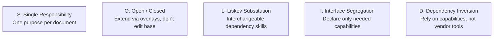

# Anchor Skills — Design Principles & Instruction Architecture

This document articulates how classical **Object-Oriented Programming (OOP), SOLID, and DRY principles** are applied to organize **skill instructions, documentation, and prompt workflows**—rather than software application code.

---

## 1. OOP Mental Model for Instruction Organization

When managing dozens of AI skills across multiple domains, unstructured prompt writing leads to context pollution, conflicting directives, and unmaintainable prompt bloat. Anchor Skills treats instruction sets as modular, engineered components:

```text
┌────────────────────────────────────────────────────────┐
│                      ABSTRACTION                       │
│    Skills expose clean capabilities (e.g. English      │
│    Writing); consumers do not care how rules work      │
└───────────────────────────┬────────────────────────────┘
┌───────────────────────────▼────────────────────────────┐
│                     ENCAPSULATION                      │
│     Internal rules stay inside their skill folders;    │
│     deep heuristics in references/; scoped memory only │
└───────────────────────────┬────────────────────────────┘
┌───────────────────────────▼────────────────────────────┐
│                      COMPOSITION                       │
│       Assemble effective capabilities: Resume Skill     │
│       invokes English Writing sub-skill via pointer    │
└───────────────────────────┬────────────────────────────┘
┌───────────────────────────▼────────────────────────────┐
│                      POLYMORPHISM                      │
│      Identical skill instructions execute across       │
│      different AI runtimes (Claude, Gemini, OpenAI)   │
└───────────────────────────┬────────────────────────────┘
┌───────────────────────────▼────────────────────────────┐
│                  DEPENDENCY INVERSION                  │
│       Consumers depend on capability pointers, not      │
│       hardcoded rules or vendor-specific tools         │
└────────────────────────────────────────────────────────┘
```

### 1.1 Abstraction
* **Definition**: A skill defines *what* it accomplishes as a reusable capability without forcing consumers to understand its internal mechanisms.
* **Instruction Practice**: `skills/english-writing/SKILL.md` exposes: *"Produce grammatically correct, active, professional English while preserving factual meaning."* The consumer (`resume-generator`) invokes this capability without needing to know how tense tables or punctuation rules are structured internally.

### 1.2 Encapsulation & Progressive Disclosure
* **Definition**: Information is strictly compartmentalized. Supporting knowledge is hidden until the AI actively needs it.
* **Instruction Practice**: 
  * Grammar rules are encapsulated inside `skills/english-writing/references/grammar-rules.md`. `resume-generator` does **not** copy or embed them.
  * Memory access is encapsulated into minimal scopes (`identity.education`, `experience.backend`). The skill never receives the user's entire personal history.

### 1.3 Composition & Reusability
* **Definition**: Powerful capabilities are built by combining independent, focused skills rather than writing monolithic super-prompts:

$$\text{Effective Task} = \text{Domain Skill (Resume)} + \text{Reusable Sub-Skill (English Writing)} + \text{Scoped Memory}$$

* **Instruction Practice**: `english-writing` is authored once as an independent skill. It is reused by:
  ```text
  english-writing (Skill)
  ▲       ▲       ▲       ▲
  │       │       │       │
  Resume  Email  LinkedIn Reports
  ```

### 1.4 Polymorphism & Portability
* **Definition**: The same skill package executes predictably across diverse AI environments without modifying the core instruction text.
* **Instruction Practice**: `skills/resume-generator/SKILL.md` is identical whether run by Claude, Gemini, or OpenAI. The provider's adapter handles discovery and tool invocation; the core instructions remain 100% portable.

### 1.5 Dependency Inversion Principle (DIP)
* **Definition**: High-level instructions must depend on abstract capabilities and explicit skill pointers, never on hardcoded vendor APIs or duplicate rules.
* **Instruction Practice**:
  * **Correct**: `resume-generator` declares: `"Execute REQUIRED SUB-SKILL: english-writing"`.
  * **Incorrect**: `resume-generator` embeds its own duplicate grammar rules or hardcodes vendor tool calls.

---

## 2. SOLID Principles Applied to Prompt & Skill Engineering



### S — Single Responsibility Principle (SRP)
* **Rule**: Each document and skill in the repository has exactly one distinct responsibility:
  * `skills/resume-generator/`: Knows how to analyze JDs, map evidence, plan sections, and format 1-page resumes.
  * `skills/english-writing/`: Knows how to check grammar, tense, parallel structure, and clarity.
  * `references/jd-analysis.md`: Classifies job requirements.
  * `references/layout.md`: Governs typography, margins, and vertical rhythm.

### O — Open/Closed Principle (OCP)
* **Rule**: Skills are open for extension (via configuration overrides and overlays) but closed for modification (upstream baselines remain untouched).
* **Application**: Adding an explicit 1-column layout override changes `config.yaml` without altering the core content workflow.

### L — Liskov Substitution Principle (LSP)
* **Rule**: A shared skill or external dependency can be substituted with another compatible skill without breaking the calling workflow.
* **Application**: If `english-writing` is enhanced or substituted with an advanced editing skill adhering to the same input/output contract, `resume-generator` continues functioning without edits.

### I — Interface Segregation Principle (ISP)
* **Rule**: A skill should never be forced to declare, load, or depend on instructions it does not use.
* **Application**:
  * `resume-generator` declares: `memory: required`, `sub_skills: [english-writing]`.
  * A pure formatting skill declares `memory: forbidden` and `sub_skills: []`.
  * English writing is loaded on demand, not globally enforced for tasks that do not write prose (e.g., JSON formatting).

### D — Dependency Inversion Principle (DIP)
* **Rule**: High-level task workflows depend on capability declarations, leaving native AI environments to supply the concrete tools.
* **Application**: If a skill needs current company terminology, it declares `web: optional`. Whether Claude uses `web_search` or Gemini uses Google Search is transparent to the skill.

---

## 3. DRY (Don't Repeat Yourself) Across the Skill Graph

Prompt duplication is a major source of instruction drift and maintenance failure.

* **Anti-Pattern**:
  ```text
  resume-generator/references/grammar.md
  email-writing/references/grammar.md
  linkedin-writing/references/grammar.md
  cover-letter/references/grammar.md
  ```
  Result: 4 duplicate copies, 4 maintenance points, inevitable divergence.

* **Anchor Solution**:
  ```text
  skills/english-writing/references/grammar-rules.md
  ```
  All skills point to `english-writing` as a required sub-skill. One rule set; multiple consumers.

---

## 4. Direction of Dependency & Shallow Chains

To maintain stability across the repository:

1. **One-Way Dependency**:
   * `resume-generator` depends on $\rightarrow$ `english-writing`.
   * `english-writing` has **zero knowledge** of `resume-generator`.
2. **Shallow Chains (1 Level Deep)**:
   * Keep cross-skill dependencies 1 level deep:
     $$\text{Resume Generator} \rightarrow \text{English Writing}$$
   * Avoid deeply nested chains 4–5 levels deep ($\text{Resume} \rightarrow \text{Writing} \rightarrow \text{Grammar} \rightarrow \text{Language} \rightarrow \text{Rules}$), which cause models to lose task context.

---

## 5. Anti-Vibe-Coding Rules for Skill Authoring

Skills are engineering assets, not casual chat prompts. All instructions must adhere to the following standards:

1. **Delete Fluff**: Remove cheerleading language (*"You are a world-class resume genius"*, *"Make it amazing!"*). Modern models respond to clear constraints, input schemas, and deterministic rubrics.
2. **The "What Breaks?" Test**: For every rule or sentence in a skill, ask: *"What degrades in the AI's output if this line is deleted?"* If the answer is "nothing," delete it.
3. **Concrete Formulas Over Vague Directives**:
   * Instead of *"Write impactful bullets"*, specify:
     $$\text{Bullet} = \text{Past-Tense Action Verb} + \text{Technical Core / Tool} + \text{Quantified Impact / Scale}$$
   * Instead of *"Make it ATS friendly"*, specify:
     * Extractable vector text only (no image-embedded contact info).
     * Standard section headings (`Experience`, `Education`, `Skills`, `Projects`).
     * Zero unverified keyword fabrication.
4. **Determinism Over Hallucination**:
   * **One-Analysis Pass**: Direct the AI to catalog all gaps and issues in an **Issue Manifest** before generating drafts.
   * **One-Correction Pass**: Direct the AI to fix all identified issues simultaneously, preventing multi-turn trial-and-error loops.

---

## 6. Build Flow vs. Use Flow

Anchor Skills maintains a crisp boundary between how skills are authored and how skills are executed:

```text
┌────────────────────────────────────────────────────────┐
│                      BUILD FLOW                        │
│   (Developer using Antigravity IDE & Git)              │
│                                                        │
│   Design Skill Contract → Draft References → Test      │
│   with Mock Scenarios → Commit to GitHub Library       │
└───────────────────────────┬────────────────────────────┘
                            │
                            ▼
┌────────────────────────────────────────────────────────┐
│                       USE FLOW                         │
│   (End-User interacting with Claude, Gemini, OpenAI)   │
│                                                        │
│   User prompts AI → AI discovers SKILL.md → Reads      │
│   references on demand → Invokes sub-skills → Queries  │
│   Notion if needed → Delivers verified output          │
└───────────────────────────┴────────────────────────────┘
```
