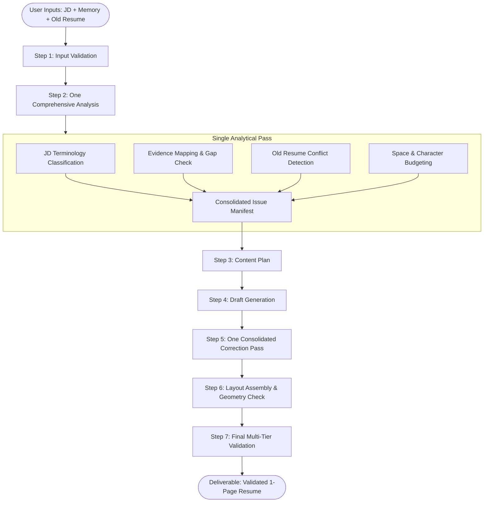

# Phase 1 Specification — Resume Generator Skill Package

This document specifies the design, structure, and execution contracts for **Phase 1: Resume Generator**, the first complete skill package in **Anchor Skills**.

---

## 1. What is Phase 1?

Phase 1 is **not** a Python application, not a resume backend, and not a PDF microservice.

Phase 1 is the creation of a **production-grade, self-contained AI skill package**:

```text
skills/resume-generator/
│
├── SKILL.md                 # Primary workflow, triggers, inputs, contracts, and rules
├── config.yaml              # Default configuration (1-page 2-col default, 1-col override)
│
├── references/              # Progressive disclosure knowledge modules
│   ├── jd-analysis.md       # Classification taxonomy for requirements & terminology
│   ├── content.md           # Bullet formulas: Action + Technical Work + Result
│   ├── grammar.md           # Active voice, tense consistency, and parallel phrasing
│   ├── layout.md            # Geometry tokens, vertical rhythm, and typography
│   └── validation.md        # Comprehensive pre-delivery verification checklist
│
├── examples/                # High-quality benchmark inputs and reference outputs
│   ├── sample-jd.md
│   ├── sample-candidate.md
│   └── sample-output.md
│
└── links/                   # Pointers to shared principles and external baselines
    ├── shared-skills.md     # Links to shared/engineering/oop.md, etc.
    └── external-skills.md   # Links to external community skills
```

---

## 2. Frozen Requirements & Input Contracts

The Resume Generator skill instructs the AI to require and process five specific inputs:

```text
1. Job Description (JD)               [Required]
2. Candidate Memory / Profile         [Required: from Notion Brain]
3. Old Resume                         [Optional: historical artifact]
4. Layout Override                    [Optional: default = 1-page, 2-column]
5. Additional User Instructions       [Optional]
```

### Layout Defaults vs. User Override
The skill implements **configuration overriding a default**, preserving a single unified content workflow:

```text
No explicit layout request
        ↓
Default = 1 Page / 2 Columns (62/38 asymmetric split)

Explicit "1 page 1 column" request
        ↓
Override = 1 Page / 1 Column (Single vertical flow)
```

The content engine generates the exact same verified accomplishments; only the presentation grid and section placement adapt based on configuration.

---

## 3. Old Resume as a Historical Artifact (Authority Control)

An old resume is **not** canonical candidate memory. It is a historical reference document.

The skill enforces a strict precedence hierarchy when extracting data:

$$\text{Verified Current Candidate Data} > \text{Explicit Current User Instruction} > \text{Old Resume Content} > \text{AI Inference}$$

### Conflict Resolution Protocol
If an old resume contains information that conflicts with current verified memory (e.g., outdated graduation date, superseded job title, obsolete tech stack):
1. **Detect the conflict** during the analysis phase.
2. **Never silently adopt the old version**.
3. **Prefer authoritative current memory** and log the discrepancy in the analysis summary.

---

## 4. Zero-Fabrication Rule (Evidence Mapping)

A resume is not created by blindly echoing keywords from the job description:

```text
JD Requirement (e.g., Spring Boot)
        ↓
Candidate Evidence in Notion Brain?
        │
   ┌────┴────┐
  YES        NO
   │          │
   ▼          ▼
 Use in    DO NOT FABRICATE
 resume    (Highlight adjacent verified skills
            only if truthful and relevant)
```

* If a JD demands **Kubernetes** and the candidate has no verified evidence of using Kubernetes, the skill strictly prohibits inventing Kubernetes bullets or adding it to the skills section.
* Every resume claim must be directly traceable to verified personal evidence.

---

## 5. The One-Analysis / One-Fix Workflow

To eliminate inefficient, multi-turn LLM regeneration loops, the skill directs the AI through a **two-pass deterministic pipeline**:



### Complete Issue Manifest
The analysis pass catalogs all known problems into a structured manifest before drafting:
* **P0 Issues**: Unsupported claims, missing required evidence, hard layout conflicts.
* **P1 Issues**: Weak bullet framing, missing relevant keywords, poor section ordering.
* **P2 Issues**: Minor wording polish, whitespace optimization.

All issues are resolved together in **one consolidated correction pass**.

---

## 6. Progressive Disclosure Reference Modules

The `SKILL.md` workflow delegates deep domain heuristics to modular files in `references/`:

### `references/jd-analysis.md`
Instructs the AI on classifying job description text into distinct categories:
* **Technical Skills & Tools**: Languages, frameworks, databases, cloud platforms.
* **Core Responsibilities**: System design, API development, incident mitigation.
* **Engineering Practices**: TDD, code reviews, CI/CD, secure coding.
* **Domain Concepts**: Fintech, payment gateways, microservices.
* **Behavioral Signals**: Cross-functional collaboration, mentorship.

### `references/content.md`
Defines section priorities and bullet writing formulas:
$$\text{Accomplishment Bullet} = \text{Strong Action Verb} + \text{Technical Contribution / Tool} + \text{Quantified Impact / Scale}$$
* Prohibits passive phrasing (*"Responsible for..."*, *"Worked on..."*).
* Defines rules for Skills, Experience, Projects, and Education sections.

### `references/grammar.md`
Enforces linguistic consistency:
* **Tense Consistency**: Past tense for previous roles; present tense for current active roles.
* **Parallel Structure**: All bullets in a section must start with grammatically parallel forms (e.g., all active verbs).
* **Fluff Elimination**: Prohibits filler adjectives (*"passionate"*, *"results-driven"*, *"visionary"*).

### `references/layout.md`
Defines layout tokens, geometry, and vertical rhythm:
* **Typography hierarchy**: Section headings, roles, companies, dates, body text, and bullets.
* **Vertical rhythm**: Standardized vertical gaps between sections, items, and bullets.
* **Column geometry**: 2-column asymmetric grid (62% primary / 38% secondary) vs. 1-column single-stream flow.
* **Page budgeting**: Guidelines to guarantee that content fits cleanly on exactly one page without awkward trailing lines or cramped margins.

### `references/validation.md`
Provides a multi-tier pre-flight verification rubric:
* **Structural**: Exactly 1 page; all required sections present.
* **Content**: Zero unverified claims; all bullets follow the evidence formula.
* **Grammar**: 100% active voice; correct tenses; zero fragments.
* **ATS Compatibility**: Clean heading hierarchy; no image-embedded text; standard section names.

---

## 7. Definition of Done (DoD) for Phase 1

The Phase 1 Resume Generator is complete when:
- [ ] `skills/resume-generator/SKILL.md` is authored with complete YAML frontmatter and clear workflow instructions.
- [ ] `config.yaml` defines default (2-column) and override (1-column) tokens.
- [ ] `references/jd-analysis.md` provides unambiguous terminology classification rules.
- [ ] `references/content.md` formalizes bullet impact formulas and section hierarchies.
- [ ] `references/grammar.md` formalizes active voice, tense, and parallel structure rules.
- [ ] `references/layout.md` specifies typography scales, margins, and vertical rhythm tokens.
- [ ] `references/validation.md` provides an exhaustive pre-flight verification rubric.
- [ ] Realistic examples (`examples/`) demonstrate the contract in action.
- [ ] Pointers (`links/`) link to shared engineering and writing principles.
- [ ] The skill is verified against the 3 core test scenarios (Default 2-col, 1-col override, and Old Resume conflict detection).
