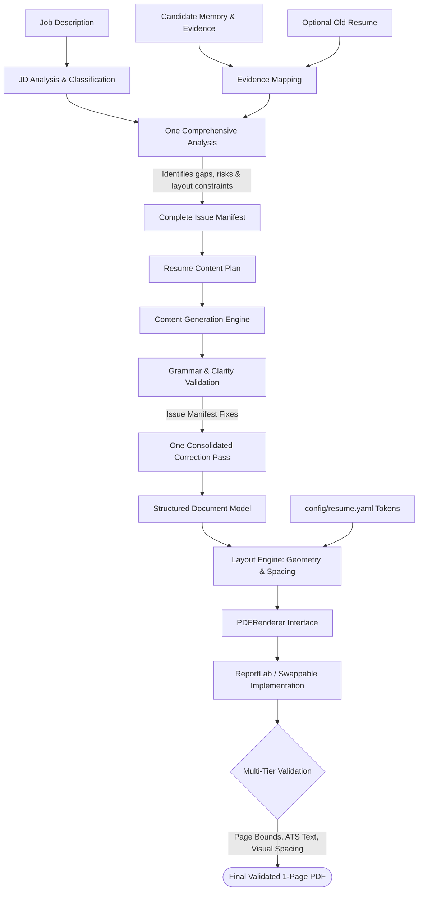

# Phase 1 Specification — Resume Generator Skill

This document provides the complete, authoritative specification for **Phase 1: Resume Generator**, the first vertical slice of **Anchor Core**.

---

## 1. Why the Resume Generator as Phase 1?

The Resume Generator is specifically chosen as the first milestone because it serves as an ideal vertical slice, exercising every core system concept in a single, bounded domain:

* **Personal Memory**: Retrieves scoped candidate facts and verified project accomplishments.
* **External Task Context**: Ingests and decomposes an unstructured Job Description (JD).
* **Historical Input**: Integrates previous resume artifacts without treating them as immutable truth.
* **Declarative Configuration**: Demonstrates configuration-over-duplication (1-column vs. 2-column layout).
* **Strict Evidence Verification**: Enforces zero-fabrication rules when mapping JD requirements to candidate facts.
* **Separation of Concerns**: Strictly decouples Content Generation from Layout Planning and PDF Rendering.
* **Multi-tier Validation**: Combines mechanical validation (page bounds, text extractability) with semantic validation (grammar, ATS alignment).

---

## 2. Input Contracts & Precedence Model

The Resume Generator operates on five inputs:

```text
1. Job Description (JD)               [Required]
2. Candidate Information & Evidence   [Required]
3. Old Resume                         [Optional]
4. Layout Override                    [Optional: default = 1-page, 2-column]
5. Additional User Instructions       [Optional]
```

### Truth and Precedence Hierarchy
When historical documents or job descriptions conflict with candidate records, the following strict hierarchy applies:

$$\text{Verified Current Candidate Facts} > \text{Explicit Current User Instruction} > \text{Previous Resume} > \text{AI Inference}$$

* **Never Fabricate**: If a JD demands *Kubernetes* and the candidate has no verified evidence of using Kubernetes, the skill **must not** invent experience. It may highlight adjacent containerization skills (e.g., Docker) only if truthful and explicitly labeled.
* **Historical Artifact Role**: An old resume provides phrasing cues and structural ideas, but is treated as a historical artifact, not an authoritative source of truth.

---

## 3. Layout Defaults & User Overrides

Anchor Core adheres to **configuration-driven layout**:

```
                  Content Generation Pipeline
                               │
                               ▼
                    Structured Resume Document
                               │
               ┌───────────────┴───────────────┐
               ▼                               ▼
       DEFAULT CONFIGURATION          USER OVERRIDE CONFIG
       • 1 Page                       • 1 Page
       • 2 Columns (Asymmetric)       • 1 Column (Single Flow)
       • Left: Skills, Experience     • Sequential Top-Down
       • Right: Contact, Education    • Universal ATS Focus
```

* **Default**: Exactly 1 page, 2 columns.
* **Explicit Override**: Exactly 1 page, 1 column.
* The content engine generates identical verified content blocks; only the presentation grid and section placement adapt.

---

## 4. End-to-End Content & Layout Pipeline



---

## 5. The One-Analysis / One-Fix Principle

Conventional LLM pipelines suffer from endless trial-and-error loops (generate $\rightarrow$ find one error $\rightarrow$ regenerate $\rightarrow$ break layout $\rightarrow$ patch $\rightarrow$ repeat).

Anchor Core enforces a **two-pass deterministic pipeline**:

1. **One Comprehensive Analysis**:
   * Analyzes JD requirements vs. candidate evidence.
   * Identifies grammar flaws and phrasing weaknesses.
   * Detects historical conflicts from the old resume.
   * Predicts layout and space constraints (character/word counts per section).
   * Generates a single, consolidated **Issue Manifest**.
2. **One Comprehensive Correction Pass**:
   * Applies all fixes simultaneously to produce the final structured document.
3. **Mechanical Verification**:
   * Evaluates the rendered output programmatically against page limits and bounding boxes.

---

## 6. Separation of Concerns: Content Engine vs. Layout Engine

| Dimension | Content Engine | Layout Engine |
| :--- | :--- | :--- |
| **Responsibility** | What to say, how to frame accomplishments, truth verification, grammar, action verbs. | Where to place elements, spatial dimensions, margins, font sizes, line heights, bounding boxes. |
| **Inputs** | Candidate evidence, JD keywords, communication style guidelines. | Structured document sections, page geometry tokens (`resume.yaml`). |
| **Outputs** | Structured semantic tree (`Document -> Section -> Entry -> Bullet`). | Coordinate trees, column allocations, PDF canvas draw commands. |
| **Independence** | Zero knowledge of PDF libraries, points, millimeters, or canvas coordinates. | Zero modification of textual phrasing, factual claims, or evidence. |

---

## 7. Central Design System & Typography Tokens

All visual constants are centralized in `config/resume.yaml`. No hardcoded numerical coordinates or font sizes may appear in Python/JS rendering code.

```yaml
# config/resume.yaml (Excerpt)
page:
  format: "A4"
  margins:
    top: 36       # 0.5 inch (36 pt)
    bottom: 36
    left: 36
    right: 36

typography:
  font_family: "Helvetica" # Universal sans-serif default
  name:
    size: 20
    leading: 24
    weight: "Bold"
  section_heading:
    size: 11
    leading: 14
    weight: "Bold"
    space_after: 6
  body:
    size: 9.5
    leading: 12.5
    weight: "Regular"
  bullet:
    size: 9.0
    leading: 12.0
    indent: 12

layout:
  two_column:
    gutter: 18
    left_ratio: 0.62   # 62% main experience, 38% sidebar
    right_ratio: 0.38
  one_column:
    section_gap: 10
```

---

## 8. PDFRenderer Abstraction

PDF rendering is hidden behind an explicit interface to ensure total vendor and library independence:

```python
# Conceptual Abstraction Contract
class PDFRenderer(ABC):
    @abstractmethod
    def render(self, document: ResumeDocument, config: LayoutConfig) -> bytes:
        """
        Renders a structured ResumeDocument into PDF binary bytes
        according to the supplied layout configuration.
        """
        pass
```

* **Default Implementation**: ReportLab (clean, programmatic, fast, local).
* **Future Swappable Implementations**: Puppeteer/HTML, Weasyprint, Typst.

---

## 9. Measurable ATS Principles vs. Buzzwords

Anchor Core rejects nebulous claims like *"100% ATS Optimized"*. Instead, ATS compliance is enforced through **measurable, programmatic checks**:

1. **Extractable Text**: Programmatic verification via `pypdf` or `pdfplumber` that all textual content can be extracted without garbled glyphs or missing characters.
2. **No Image-Only Content**: Ensures that headers, contact information, and body text are rendered as vector text, not rasterized images.
3. **Logical Reading Order**: Confirms that column geometry preserves semantic reading order when parsed linearly.
4. **Standard Section Terminology**: Employs industry-standard headings (`Experience`, `Education`, `Skills`, `Projects`) recognizable by automated parsers.
5. **Traceable Evidence**: Keywords directly correspond to verified accomplishments rather than stuffed keyword blocks.

---

## 10. Phase 1 Implementation Steps (18 Sequential Milestones)

Development proceeds one component at a time:

```text
Step 1:  Establish Phase 1 directory structure
Step 2:  Author Resume Skill Contract (SKILL.md)
Step 3:  Define Resume Input schema & validation models
Step 4:  Define Resume Configuration model & tokens (resume.yaml)
Step 5:  Define JD Analysis interface
Step 6:  Implement JD Analysis & term classification
Step 7:  Define Candidate Evidence interface
Step 8:  Implement Evidence Mapping & zero-fabrication rules
Step 9:  Define Resume Content Plan schema
Step 10: Implement Content Generation engine
Step 11: Implement Grammar & Parallel Structure validation
Step 12: Define Document Model (semantic tree)
Step 13: Implement Layout Planning engine (coordinate & column calculator)
Step 14: Define PDFRenderer interface
Step 15: Implement ReportLab PDF renderer
Step 16: Implement Structural & Text-Extraction validation
Step 17: Implement Visual & Layout Overflow validation
Step 18: Execute End-to-End integration test suite
```

---

## 11. Test Cases for Phase 1

| Test ID | Test Scenario | Input Conditions | Expected Outcome |
| :---: | :--- | :--- | :--- |
| **TEST-01** | **Default Layout** | Standard JD + Candidate Evidence | Generates valid PDF; exactly 1 page, 2 columns. |
| **TEST-02** | **One-Column Override** | Standard JD + Candidate + `"1-column"` | Generates valid PDF; exactly 1 page, single continuous column. |
| **TEST-03** | **Old Resume Input** | JD + Candidate + Outdated Resume | Current verified facts override old resume dates/roles; historical wording adapted where truthful. |
| **TEST-04** | **Unsupported Skill** | JD requires *Kubernetes*; candidate has none | Kubernetes is **not** fabricated in skills or bullets; adjacent skills noted truthfully. |
| **TEST-05** | **Grammar & Clarity** | Input contains poor sentence framing/tense | Generates polished, active-voice, past-tense bullets with zero factual distortion. |
| **TEST-06** | **Confidential Evidence** | Candidate record contains L3 (Restricted) data | L3 information is completely redacted and absent from final output. |
| **TEST-07** | **Layout Overflow** | Large volume of candidate experience | Layout engine applies deterministic prioritization rules to fit exactly 1 page without micro-scaling font below legible limits. |
| **TEST-08** | **Provider Isolation** | Execution within Claude adapter vs. standalone | Core resume logic executes identically regardless of provider wrapper. |

---

## 12. Phase 1 Definition of Done (DoD)

Phase 1 is strictly declared complete only when every item below is verified:

* [ ] Resume Skill definition exists with full YAML contract (`anchor-skills/skill/resume/SKILL.md`).
* [ ] Input contract validates JD, Candidate facts, Old Resume, and Overrides.
* [ ] Central configuration tokens exist in `config/resume.yaml`.
* [ ] Layout engine supports 2-column default and 1-column user override.
* [ ] JD analysis is decoupled from content generation.
* [ ] Candidate evidence mapping enforces zero-fabrication of unverified claims.
* [ ] Old resume is treated strictly as an optional historical artifact.
* [ ] Grammar and parallel structure validation is automated.
* [ ] Content Engine is strictly decoupled from Layout Engine.
* [ ] PDF generation is abstracted behind `PDFRenderer`.
* [ ] Output PDF is guaranteed to be exactly 1 page.
* [ ] Text is 100% extractable and ATS readable.
* [ ] Confidentiality boundaries (L0–L4) are respected.
* [ ] One comprehensive analysis produces a consolidated Issue Manifest.
* [ ] One correction pass resolves identified issues.
* [ ] Claude provider adapter packages the skill cleanly.
* [ ] All 8 test cases pass verification.
