# Anchor Skills — Phased Implementation Roadmap

This document outlines the disciplined, phased roadmap for building, organizing, and extending **Anchor Skills** as a modular, provider-independent skill library.

---

## 1. Roadmap Overview

```mermaid
graph LR
    P1[Phase 1: Resume + English Writing Skills] --> P2[Phase 2: Shared Skills & Overlays]
    P2 --> P3[Phase 3: Provider Adapters]
    P3 --> P4[Phase 4: Notion Brain Linking]
    P4 --> P5[Phase 5: Capability Declarations]
    P5 --> P6[Phase 6: Quality & Validation Rubrics]
    P6 --> P7[Phase 7: Provenance & Metadata]
    P7 --> P8[Phase 8: Emergency Medpack]
    P8 --> P9[Phase 9: Additional Domain Skills]
    P9 --> P10[Phase 10: Catalog Automation]
```

---

## 2. Phase-by-Phase Deliverables

### Phase 1: Two-Skill Composition — English Writing & Resume Generator (Active Milestone)
* **Objective**: Build the foundational independent reusable skill (`english-writing`) and the domain consumer skill (`resume-generator`), proving cross-skill composition and DRY without prompt duplication.
* **Deliverables**:
  * **Skill 1 (`skills/english-writing/`)**:
    * `SKILL.md`: 10-step correction workflow preserving factual meaning while fixing syntax, tense, and voice.
    * `references/grammar-rules.md`: Comprehensive passive rules lookup.
  * **Skill 2 (`skills/resume-generator/`)**:
    * `SKILL.md`: Master workflow referencing `english-writing` in Step 5 before finalizing text.
    * `config.yaml`: Visual layout tokens (1-page 2-col default, 1-col override, typography, margins).
    * `references/`: `jd-analysis.md`, `content.md`, `layout.md`, `validation.md`.
    * `examples/`: Benchmark JD, candidate evidence, and 1-page output.
    * `links/dependencies.md`: Pointer to `english-writing`.

### Phase 2: Shared Knowledge & External Skill Overlays
* **Objective**: Establish the `shared/` library and prove that external skills can be customized via overlays without cloning or forking.
* **Deliverables**:
  * Shared engineering standards in `shared/engineering/` (`oop.md`, `solid.md`, `dry.md`).
  * Shared writing standards in `shared/writing/` (`active-voice.md`, `conciseness.md`).
  * Integration of `obra/superpowers` via personal overlays (`ADD`, `REPLACE`, `RESTRICT`, `PRIORITISE`).

### Phase 3: Provider Adapters & Portability
* **Objective**: Package universal skills for distinct AI environments without modifying the underlying skill markdown.
* **Deliverables**:
  * Claude Adapter: Packaging skills for Claude Code / Desktop (`adapters/claude/`).
  * Gemini Adapter: Packaging skills for Gemini / Antigravity (`adapters/gemini/`).
  * OpenAI Adapter: Formatting skills for OpenAI Custom GPTs / Assistants (`adapters/openai/`).

### Phase 4: Notion Brain Linking & Scoped Queries
* **Objective**: Define formal prompt protocols for querying the user's existing Notion Brain with minimum context and strict visibility tiers.
* **Deliverables**:
  * Scoped retrieval guides (`identity.education`, `experience.backend`, `projects.relevant`).
  * Enforcement of visibility boundaries (L0 Public, L1 Professional, L2 Private, L3 Restricted, L4 Retired).
  * Zero ambient context leakage: prompt templates that request only task-relevant evidence.

### Phase 5: Capability Declarations & Progressive Resolution
* **Objective**: Standardize frontmatter capability schemas across all skills.
* **Deliverables**:
  * Standardized declarations: `memory: required/optional/forbidden`, `web: optional`, `tools: [filesystem, terminal]`.
  * Instructions for AI fallback behavior when optional tools (e.g., web search) are unavailable.

### Phase 6: Skill Quality & Validation Rubrics
* **Objective**: Establish pre-flight verification rubrics that prevent AI output drift.
* **Deliverables**:
  * Deterministic validation checklists for each domain skill.
  * Self-correction protocols: guiding the AI to audit its own output against constraints before presenting deliverables.

### Phase 7: Provenance & Artifact Metadata
* **Objective**: Establish structured headers and provenance audit blocks for generated artifacts.
* **Deliverables**:
  * Provenance schemas: tracking which skill version, Notion evidence records, and layout configurations produced an artifact.
  * Audit blocks: logging assumptions, omitted content, or unresolved conflicts.

### Phase 8: Emergency Medpack (Degraded Fallback)
* **Objective**: Provide ultra-lightweight, zero-dependency emergency skills for mobile devices or restricted offline environments.
* **Deliverables**:
  * Single-file emergency skills requiring zero external references or tools.
  * Graceful degradation paths that output clean Markdown when full layout formatting is unavailable.

### Phase 9: Domain Skills Expansion
* **Objective**: Expand the Anchor Skills library across professional and technical domains.
* **Deliverables**:
  * `skills/cover-letter/`: Paired companion to the Resume Skill (reusing `english-writing`).
  * `skills/email-writing/`: Professional communication (reusing `english-writing`).
  * `skills/linkedin-writer/`: Technical posts and profile summaries (reusing `english-writing`).
  * `skills/hackathon-evaluator/`: Fast opportunity assessment and tech stack scoping.
  * `skills/architecture-review/`: Systematic design critique applying shared OOP/SOLID principles.

### Phase 10: Catalog Automation & Maintenance
* **Objective**: Lightweight maintenance utilities for repository organization.
* **Deliverables**:
  * Automated index generator updating `README.md` from skill metadata.
  * Broken link and dependency reference checker across markdown files.
