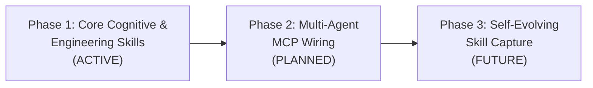

# Skill Shelf — Evolution Roadmap

This document outlines the strategic, phased evolution of **Skill Shelf** as the universal procedural brain for autonomous AI agents.

---

## Roadmap Overview

---

## Phase 1: Core Cognitive & Engineering Skills (Active Milestone)

### Objective
Establish the foundational procedural skill library, 2-tier progressive disclosure engine, repository governance, and automated validation tooling.

### 1. Cognitive Skills
* **`skills/core-thinking/`**:
  * First-principles decomposition: breaking complex ambiguity into fundamental truths.
  * Explicit trade-off matrix: comparing architectural alternatives across cost, latency, complexity, and maintainability.
  * Upfront failure modes analysis: identifying edge cases and breaking conditions before execution.
  * High-signal, concise communication standards.
  * Modular references: `references/mental-models.md`.
* **`skills/brainstorm-and-validate/`**:
  * 4-step wedge discovery framework: identifying high-leverage entry points.
  * Competitor and ROI gate: objective feasibility and market differentiation rubrics.
  * One-question-at-a-time interactive specification loop.
  * Modular references: `references/discovery-framework.md`, `references/validation-rubric.md`.
* **`skills/english-writing/` (Preserved Legacy Core)**:
  * Reusable language engine providing 5 operational modes (Proofreading, Substantive Editing, Formatting, Executive Summary, Composition).
  * Meaning and Claim Invariants: preventing hallucination and tone inflation.
  * Deep references: sentence structure, verb system, professional writing, composition craft.

### 2. Engineering Skills
* **`skills/planning-and-architecture/`**:
  * SOLID principles and Clean Architecture boundaries.
  * Thin controller pattern and isolated domain models.
  * Architectural Decision Records (ADR) generation.
  * Bite-sized, testable task plans specifying exact file paths and verification commands.
  * Modular references & assets: `references/task-plan-template.md`, `references/engineering-standards.md`, `assets/adr-template.md`.
* **`skills/systematic-debugging/`**:
  * 4-phase root-cause tracing: Symptom Observation $\rightarrow$ Minimal Reproduction $\rightarrow$ Mechanism Tracing $\rightarrow$ Regression Defense.
  * Strict evidence-before-hypothesis rule: no speculative code changes without reproducible proof.
  * Modular references: `references/root-cause-checklist.md`.
* **`skills/code-review/`**:
  * Subagent diff review and change analysis.
  * Severity triage system: Critical (blocking) vs. Important (must fix) vs. Minor (nitpicks).
  * Red flags table: identifying anti-patterns, memory leaks, and concurrency hazards.
  * Test execution verification: ensuring all assertions actively run and pass.
  * Modular references: `references/review-rubric.md`.

### 3. Governance & Repository Standard
* **`INDEX.md`**: Master intent routing table directing user prompts to exact skill paths.
* **`AGENTS.md`**: Universal repo rules enforcing the `agentskills.io` standard:
  * Strict `<120 lines` limit for all new `SKILL.md` files.
  * Mandatory `overrides.md` in every skill directory.
  * Mandatory frontmatter schema (`name` matching directory, `description <= 1024 chars`).
  * Zero personal secrets, API keys, or private bios in the repository.
* **`README.md`**: Updated with the Dual-Brain USB-C model, repository structure, and quickstart.

### 4. Tooling & Automation
* **`scripts/validate_skills.py`**: Python standard library script validating YAML frontmatter, line counts, relative links, and `overrides.md` presence.
* **`scripts/bundle_skills.py`**: Flattens skills (`SKILL.md` + `references/` + `overrides.md`) into single-file bundles in `dist/` for chat-only web/mobile interfaces.
* **`scripts/sync.ps1` & `scripts/sync.sh`**: Cross-platform symlinking and copying utilities linking skills to `~/.gemini/skills`, `~/.claude/skills`, `~/.codex/skills`, and `~/.hermes/skills`.

---

## Phase 2: Multi-Agent MCP Wiring

### Objective
Wire the remote HTTP MCP zero-server architecture across all target agent environments, establish declarative Notion memory schemas, and enable multi-agent swarm collaboration.

### Deliverables
1. **Universal Remote HTTP MCP Integration**:
   * Implement and verify remote MCP connections across Google Antigravity, Claude Code, Codex/OpenCode, and Hermes Agent.
   * Enforce strict `enabledTools` allowlists (`["get_file_contents", "search_code"]`) on the GitHub read-only endpoint (`https://api.githubcopilot.com/mcp/readonly`).
2. **Notion Declarative Memory Schemas**:
   * Standardize structured database templates for Notion declarative memory (`https://mcp.notion.com/mcp`):
     * **User Profile & Skills**: Core capabilities, career milestones, preferred coding conventions.
     * **Project Ledger**: Active initiatives, technical stack requirements, operational constraints.
     * **Architecture Decisions**: Centralized ADR log tracking technical trade-offs across systems.
     * **Knowledge Vault**: Reading notes, domain heuristics, and empirical findings.
   * Define standardized scoped query filters to eliminate ambient context leakage.
3. **Cross-Agent Swarm Orchestration**:
   * Establish protocols for multi-agent swarms (coordinators, authors, verifiers) sharing procedural skills via functional pointers.
   * Standardize handoff contracts: agents pass artifacts and reference paths rather than dumping full conversation history.
4. **Automated CI/CD & Skill Publishing**:
   * GitHub Actions workflow running `scripts/validate_skills.py` and `scripts/bundle_skills.py` on every commit and pull request.
   * Automated release tagging and artifact publishing for bundled skills.

---

## Phase 3: Self-Evolving Skill Capture

### Objective
Enable AI agents to automatically extract, validate, and publish new skills derived from real-world problem-solving sessions.

### Deliverables
1. **Autonomous Skill Extraction**:
   * Agents detect breakthrough solutions during complex debugging or architectural tasks.
   * Agent drafts a candidate `SKILL.md` following the 2-tier progressive disclosure model (<120 lines, modular references, `overrides.md`).
2. **Automated Benchmark & Regression Suite**:
   * Evaluate skill effectiveness across different LLMs (Gemini, Claude, GPT-4, Hermes) using standard benchmark prompts.
   * Measure prompt adherence, token consumption, and hallucination reduction.
3. **Dynamic Heuristic Refinement**:
   * Track which reference heuristics are most frequently accessed and refine checklists to eliminate redundant steps.
   * Incorporate post-mortem learnings directly into Tier 2 checklists.
4. **Community & Marketplace Ecosystem**:
   * Publish curated skills to the open `agentskills.io` directory.
   * Package skills as Antigravity plugins and Claude skills bundles.
