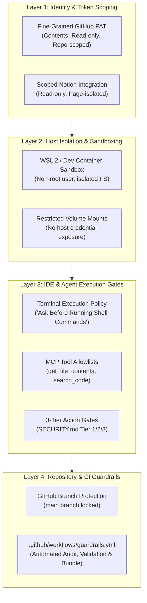

# Skill Shelf — Environment Security Checklist & Hardening Guide

> **Operational Security & Sandboxing Standard for AI Agent Workspaces**  
> This checklist details the mandatory configuration steps required outside the codebase—covering access tokens, credential isolation, IDE execution boundaries, runtime sandboxing, and repository protection—to operationalize the security invariants established in [SECURITY.md](../SECURITY.md).

---

## 1. Architectural Overview: Defense-in-Depth

Securing agentic development workflows requires a multi-layered defense strategy. No single control is sufficient; security boundaries must exist across the identity layer, host runtime, IDE execution policy, and repository levels:



---

## 2. Checklist 1: Scoping GitHub Personal Access Tokens (Fine-Grained PAT)

Traditional GitHub Personal Access Tokens (Classic PATs) grant broad, account-wide read and write permissions across all public and private repositories. When configuring read-only agent MCP connections (such as GitHub Copilot MCP or raw Git endpoints), you must generate a **Fine-Grained Personal Access Token** scoped strictly to the functional brain repository.

### Step-by-Step Configuration:
1. Navigate to: **GitHub.com** -> User Profile (top right) -> **Settings** -> **Developer settings** -> **Personal access tokens** -> **Fine-grained tokens**.
2. Click **Generate new token**.
3. Configure Token Attributes:
   - **Token name**: `agent-skill-shelf-readonly` (or `anchor-skills-mcp`).
   - **Expiration**: Select `30 days` or `90 days` (maximum). *Never set to 'No expiration'.*
   - **Description**: `Read-only procedural memory access for AI agent MCP integrations.`
   - **Resource owner**: Select your individual user account or target organization.
4. **Repository access**:
   - Select **"Only select repositories"**.
   - In the repository dropdown, choose **only** `skill-shelf` (or your private procedural memory repo).
   - *Never select "All repositories".*
5. **Permissions**:
   - Under **Repository permissions**:
     - `Contents`: Change from *No access* to **Read-only**.
     - `Metadata`: Automatically set to **Read-only** by GitHub.
     - Verify all other permissions (Actions, Administration, Commit statuses, Issues, Pull requests, Secrets, Webhooks, Workflows) remain **No access**.
   - Under **Account permissions**:
     - Ensure all permissions remain **No access**.
6. Click **Generate token** and copy the generated token immediately.
7. **Secure Environment Injection**:
   - Store the token as an operating system environment variable. Do not write the token into `.env` files or commit it to version control.
   - **Linux / macOS (`~/.bashrc` or `~/.zshrc`)**:
     ```bash
     export GITHUB_TOKEN="<YOUR_FINE_GRAINED_TOKEN>"
     ```
   - **Windows PowerShell**:
     ```powershell
     [System.Environment]::SetEnvironmentVariable('GITHUB_TOKEN', '<YOUR_FINE_GRAINED_TOKEN>', 'User')
     ```
8. **Verification**:
   - Test that the token cannot clone or read unrelated repositories:
     ```bash
     curl -s -H "Authorization: Bearer $GITHUB_TOKEN" "https://api.github.com/repos/your-user/unrelated-private-repo"
     ```

---

## 3. Checklist 2: Scoping Notion OAuth & Integration Tokens

In the Dual-Brain architecture, Notion acts as the Declarative Memory Brain ("What is true"). A compromised or over-privileged Notion token can expose sensitive personal notes, credentials, private career documentation, or financial logs.

### Step-by-Step Configuration:
1. Navigate to: **https://www.notion.so/profile/integrations**.
2. Click **New integration** (or select your existing agent integration).
3. Configure Integration Settings:
   - **Name**: `Agent Declarative Brain (Read-Only)`.
   - **Associated workspace**: Select the target Notion workspace.
   - **Type**: `Internal integration`.
4. **Configure Capabilities**:
   - **Content Capabilities**:
     - Select **Read content** ONLY.
     - Uncheck **Update content** and **Insert content** unless you have explicitly configured a dedicated write-back journal.
   - **User Capabilities**:
     - Select **No user information**.
5. Click **Save** and copy the Internal Integration Secret (`Internal Integration Token`).
6. **Explicit Page Scoping (Mandatory Isolation Step)**:
   - By default, Notion internal integrations have **zero access** to any pages in the workspace.
   - Open Notion in your browser or desktop app.
   - Navigate to the specific top-level page or database designated as the Declarative Brain (e.g., `Personal Knowledge Base` or `Agent Declarative Memory`).
   - Click the **`...` (Options)** menu at the top right of the page.
   - Scroll to **Connections** (or **Connect to**) -> Select **`Agent Declarative Brain (Read-Only)`**.
   - Confirm access.
7. **Verify Non-Access Boundary**:
   - Verify that non-relevant or sensitive pages (such as banking records, medical notes, or personal journals) do NOT have the integration connected.
8. **Secure Environment Injection**:
   - Export the secret to your environment:
     ```bash
     export NOTION_API_KEY="<YOUR_NOTION_INTEGRATION_TOKEN>"
     ```

---

## 4. Checklist 3: Setting Antigravity & IDE Terminal Execution Policy

Autonomous, unconfirmed shell execution by AI agents presents severe risks of accidental data deletion, unauthorized package installation, and execution of dangerous shell commands.

### Step-by-Step Configuration:

### 4.1 Antigravity / IDE Approval Mode
Configure your agent IDE (Antigravity, Cursor, VS Code with agent extensions, Claude Code) to require interactive human authorization before executing shell and network commands:
1. **Antigravity IDE**:
   - Open Settings (`Ctrl + ,` or `Cmd + ,`).
   - Search for `Terminal Execution Policy` or `Agent Tool Approval`.
   - Set execution mode to: **"Ask Before Running Shell/Network Commands"** (or `Prompt Every Command`).
   - Disable autonomous auto-approve flags (e.g., set `antigravity.tools.autoApproveTerminal: false`).
2. **VS Code & Cursor**:
   - Ensure `terminal.integrated.allowChaining` is disabled.
   - Verify that agent extensions run in "Ask Before Running" mode for command line operations.
3. **Claude Code**:
   - Run Claude Code in safe confirmation mode:
     ```bash
     claude --dangerously-skip-permissions=false
     ```
   - Never supply `--dangerously-skip-permissions` unless operating inside an ephemeral, disposable container.

### 4.2 Restrict MCP Tool Allowlists
When wiring `skill-shelf` to agent environments via Model Context Protocol (MCP), enforce tool allowlists in your MCP configuration files:
- Google Antigravity: `.gemini/mcp_config.json`
- Claude Code: `.mcp.json`
- Codex / OpenCode: `mcp_servers.json`

Ensure only read-only primitives are exposed:
```json
{
  "mcpServers": {
    "github-copilot-readonly": {
      "url": "https://api.githubcopilot.com/mcp/readonly",
      "headers": {
        "Authorization": "Bearer ${GITHUB_TOKEN}"
      },
      "enabledTools": [
        "get_file_contents",
        "search_code"
      ]
    }
  }
}
```
*Never expose arbitrary filesystem write or bash execution tools through MCP to untrusted remote callers.*

---

## 5. Checklist 4: Agent Runtime Sandboxing (WSL, Docker & Directory Isolation)

To protect the host operating system from unintended modification or exfiltration of sensitive developer keys, agents must be constrained to isolated execution environments.

### Option A: Windows Subsystem for Linux (WSL 2)
1. Install an isolated Linux distribution dedicated to agent development:
   ```powershell
   wsl --install -d Ubuntu-24.04
   ```
2. Create a non-root standard user account inside WSL:
   ```bash
   sudo adduser agentdev
   su - agentdev
   ```
3. Restrict host filesystem cross-mount exposure:
   - Store code inside the native Linux filesystem (`/home/agentdev/projects/skill-shelf`) rather than directly accessing `/mnt/c/Users/<user>/`.
   - Never symlink host credential folders (`/mnt/c/Users/<user>/.ssh` or `/mnt/c/Users/<user>/.aws`) into the agent's Linux path.

### Option B: Docker Dev Containers (Recommended)
Use Docker Dev Containers to encapsulate the agent workspace in a fully isolated container:
1. Create a `.devcontainer/devcontainer.json` in your project:
   ```json
   {
     "name": "Isolated Agent Workspace",
     "image": "mcr.microsoft.com/devcontainers/python:3.11-bookworm",
     "remoteUser": "vscode",
     "containerUser": "vscode",
     "runArgs": [
       "--cap-drop=ALL",
       "--security-opt=no-new-privileges"
     ],
     "workspaceMount": "source=${localWorkspaceFolder},target=/workspace,type=bind",
     "workspaceFolder": "/workspace",
     "customizations": {
       "vscode": {
         "settings": {
           "terminal.integrated.defaultProfile.linux": "bash"
         }
       }
     }
   }
   ```
2. Key security flags:
   - `--cap-drop=ALL`: Drops Linux root capabilities.
   - `--security-opt=no-new-privileges`: Prevents privilege escalation.
   - Non-root user: Executes as unprivileged user (`vscode`).
   - Host isolation: Host home directory, SSH agent socket, and cloud credentials are not mounted into the container.

### Option C: Isolated Project Directory Hygiene
If running agents directly on a developer workstation:
1. **Never launch agents from the user root**:
   - Prohibited: Running agents with working directory set to `~` or `C:\Users\<username>`.
   - Required: Run agents with working directory set to the dedicated repository root (e.g., `D:\skill-shelf`).
2. **Path Access Boundary**:
   - Strictly prohibit agents from traversing into sensitive parent directories:
     - User configuration and key rings (`~/.ssh`, `~/.aws`, `~/.gnupg`, `~/.config`)
     - Secrets and credentials files (`.env`, `credentials.json`, `token.json`)

---

## 6. Checklist 5: Setting Up GitHub Branch Protection on `main`

To prevent accidental, unauthorized, or compromised commits from corrupting the canonical procedural memory in `main`, enforce GitHub branch protection rules requiring the `guardrails` CI workflow to pass.

### Step-by-Step Configuration:
1. Open your repository on GitHub: `https://github.com/<owner>/skill-shelf`.
2. Click **Settings** (tab in repo header) -> Click **Branches** (in the left sidebar).
3. Under **Branch protection rules**, click **Add branch protection rule** (or **Edit** next to `main`).
4. **Branch name pattern**:
   - Enter `main`.
5. **Protect Matching Branches Configuration**:
   - [x] **Require a pull request before merging**:
     - Check **Require approvals** (minimum 1 approval recommended).
     - Check **Dismiss stale pull request approvals when new commits are pushed**.
     - Check **Require review from Code Owners** (if `CODEOWNERS` is configured).
   - [x] **Require status checks to pass before merging**:
     - Check **Require branches to be up to date before merging**.
     - In the search box ("Search for status checks in the last week for this repository"), search for:
       ```text
       guardrails
       ```
     - Check the **`guardrails`** status check (defined in [.github/workflows/guardrails.yml](../.github/workflows/guardrails.yml)).
   - [x] **Do not allow bypassing the above settings**:
     - Enable this option to ensure branch protection applies to repository administrators and owners as well.
   - [x] **Require conversation resolution before merging**:
     - Ensures all review comments are addressed.
   - [x] **Require signed commits** (Optional but recommended).
   - [x] **Require linear history** (Prevents merge commit clutter).
6. Under **Rules applied to everyone including administrators**:
   - Ensure **Allow force pushes** is **DISABLED** (unchecked).
   - Ensure **Allow deletions** is **DISABLED** (unchecked).
7. Click **Save changes** (confirm with your GitHub 2FA credentials).

---

## 7. Master Operational Security Checklist

Use this checklist during initial onboarding, monthly audits, or before granting new AI agents access to your environment:

| Category | Security Control | Verification Procedure | Required Status |
| :--- | :--- | :--- | :---: |
| **Identity** | Fine-Grained GitHub PAT | Scoped to single repo, read-only contents, 30-90 day max TTL | [ ] Configured |
| **Identity** | Scoped Notion OAuth | Internal integration, Read-only content, explicitly linked to Brain page only | [ ] Configured |
| **Secrets** | Zero Secrets in Repo | No tokens or keys in `.env`, `skills/`, or git history | [ ] Verified |
| **IDE** | Terminal Execution Policy | "Ask Before Running Shell/Network Commands" active | [ ] Configured |
| **IDE** | MCP Tool Allowlists | Restricted to `get_file_contents` and `search_code` only | [ ] Enforced |
| **Sandbox** | Host Isolation | Agent runs in WSL2, Docker Dev Container, or scoped workspace directory | [ ] Enforced |
| **Sandbox** | Protected Paths | Agent has no access to `~/.ssh`, `~/.aws`, `~/.gnupg`, or host user root | [ ] Verified |
| **CI / CD** | Guardrails Workflow | `.github/workflows/guardrails.yml` active on push and pull_request | [ ] Active |
| **Governance**| Branch Protection on `main` | Requires PR, requires `guardrails` status check, no force-push | [ ] Enforced |
| **Auditing** | Local Security Audit | `python scripts/security_audit.py` exits code 0 before commits | [ ] Verified |
| **Validation**| Skills Specification Check | `python scripts/validate_skills.py` exits code 0 before commits | [ ] Verified |
| **Packaging** | Distribution Bundler | `python scripts/bundle_skills.py` exits code 0 before commits | [ ] Verified |

---

## 8. Related Governance Documentation

- [SECURITY.md](../SECURITY.md) — The Repository Security Constitution & 3-Tier Action Gates
- [AGENTS.md](../AGENTS.md) — Repository Standards, Invariants, and Skill Specifications
- [.github/workflows/guardrails.yml](../.github/workflows/guardrails.yml) — Automated Guardrails CI Workflow
- [docs/agent_connection_guide.md](agent_connection_guide.md) — Multi-Agent Configuration Guide for Dual-Brain Setup
