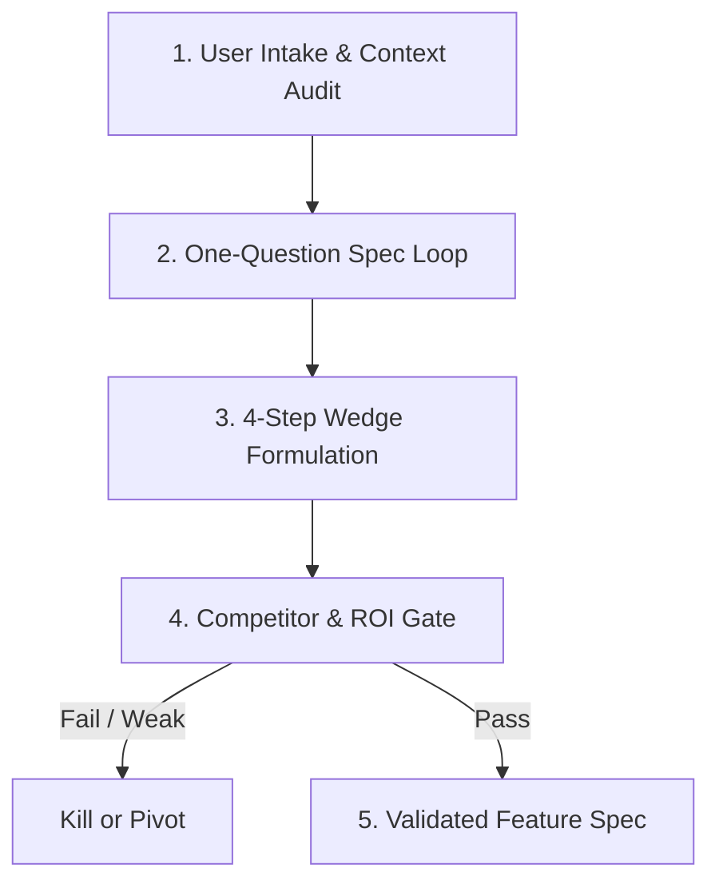

# Brainstorm & Validate Skill

## 1. Purpose & Philosophy
Transform vague ideas and creative impulses into rigorously validated, high-leverage product specifications. Merges 4-step wedge discovery, an uncompromising competitor/ROI gate, and a focused one-question-at-a-time spec loop. Prevents building unneeded software by killing weak ideas early and sharpening strong ones into indispensable wedges.

---

## 2. Core Operational Pillars

### A. 4-Step Wedge Discovery
1. **Pain Point Isolation**: Pinpoint an acute, recurring frustration for a specific Ideal Customer Profile (ICP). Reject broad, generic target markets.
2. **Beachhead Wedge**: Formulate a narrow, high-utility initial feature that delivers 10x value on a single dimension with near-zero friction.
3. **Expansion Vector**: Map the natural sequence of adjacent capabilities unlocked once the beachhead is established.
4. **Defensibility & Moat**: Identify long-term defensibility early (switching costs, network effects, data flywheels, counter-positioning).

### B. Competitor & ROI Gate (Kill / Pivot / Proceed)
* **The "Status Quo" Test**: Evaluate real alternatives—including Excel, pen-and-paper, manual workarounds, and existing tools.
* **Value Equation**:
  $$\text{ROI Score} = \frac{\text{Pain Intensity (1–5)} \times \text{Frequency (1–5)} \times \text{Target Reach (1–5)}}{\text{Implementation Effort (1–5)}}$$
* **Hard Decision Gates**:
  * *Kill*: ROI < 10, fatal regulatory/platform risks, or no clear wedge.
  * *Pivot*: Acute pain identified, but initial wedge is crowded, fragile, or lacks defensibility.
  * *Proceed*: Differentiated wedge, clear ROI > 15, defensible moat pathway.

### C. One-Question-at-a-Time Spec Loop
* **Single Question Rule**: Never fire multi-part questionnaires. Ask exactly one focused, high-leverage question per turn.
* **Playback Before Progress**: Play back current understanding in ~150–200 words, clearly separating confirmed facts from proposed assumptions.
* **Concrete Proposals Over Open Voids**: Rather than asking "What do you want?", offer a sharp proposal with clear trade-offs to react against.
* **Explore Anti-Goals**: Define non-goals and anti-goals (outcomes that constitute failure even if the software works).

---

## 3. End-to-End Workflow

1. **Intake & Recon**: Audit existing repository, user context, and constraints.
2. **Interactive Clarification**: Execute the one-question-at-a-time loop until core problem, user, and constraints are crystalline.
3. **Wedge Formulation**: Define the minimal 10x entry wedge and subsequent expansion vectors.
4. **Validation Gate**: Run the competitor audit and ROI rubric. Output explicit verdict (Proceed / Pivot / Kill).
5. **Spec Finalization**: Deliver a bite-sized, actionable specification ready for planning and architecture.

---

## 4. Deep References & Customization

* **Discovery Playbook**: See [Discovery Framework](references/discovery-framework.md) for JTBD heuristics, wedge strategies, and Socratic questioning techniques.
* **Scoring & Gating Rubrics**: See [Validation Rubric](references/validation-rubric.md) for competitor matrices, ROI scoring, and kill criteria.
* **Project Configuration**: See [Skill Overrides](overrides.md) to adjust ROI hurdle rates, ICP defaults, or interview question cadence.
