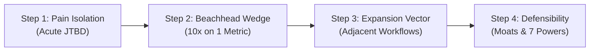

# Discovery Framework & Wedge Ideation

This reference document provides in-depth heuristics, discovery methodologies, and interview protocols for the `brainstorm-and-validate` skill.

---

## 1. The 4-Step Wedge Discovery Method

Building a broad product immediately usually leads to failure due to feature dilution and high user onboarding friction. The Wedge Method establishes a narrow, irresistible entry point that earns the right to expand.

### Step 1: Pain Point Isolation & ICP Definition
* **Jobs To Be Done (JTBD)**:
  * *Functional Job*: What core operational task is the user struggling to complete?
  * *Emotional Job*: How does failure make them feel (anxious, overwhelmed, exposed)?
  * *Social Job*: How does success affect how colleagues, bosses, or clients perceive them?
* **Isolate the ICP**: Define the initial user not by demographics, but by acute situational urgency.
  * *Poor ICP*: "Software developers."
  * *Sharp ICP*: "Solo backend engineers maintaining 5+ Node services who spend >2 hours/week manually patching dependency security alerts."

### Step 2: The Beachhead Wedge Formulation
* **10x Better on One Single Axis**: Don't try to be 10% better across 10 dimensions. Be 10x faster, cheaper, or simpler on a single, agonizing friction point.
* **Near-Zero Adoption Friction**: The user must experience value within minutes, ideally without ripping out existing tools or requiring multi-stakeholder approval.
* **Examples of Successful Wedges**:
  * *Stripe*: 7 lines of code to accept credit cards (vs. weeks of merchant account bureaucracy).
  * *Figma*: Open a URL in a browser to collaborate on designs (vs. installing heavy desktop apps and syncing files).
  * *Docker*: Package an app into a single container image (vs. configuring complex VM environments).

### Step 3: Adjacent Expansion Vectors
Once the beachhead wedge is embedded in daily workflows, identify natural adjacent expansion vectors:
* **Workflow Upstream**: What happens immediately before the user touches the wedge?
* **Workflow Downstream**: What artifact does the wedge produce, and who consumes it next?
* **Team Collaboration**: How does a single user's activity naturally invite peers into the tool?

### Step 4: Long-Term Defensibility & Moats
Anchor the product strategy in Hamilton Helmer's 7 Powers:
1. **Network Effects**: Each new user increases the value for existing users.
2. **Switching Costs**: Data accumulation and embedded workflows make replacement costly.
3. **Scale Economies**: Per-unit production or operational costs decrease as volume grows.
4. **Counter-Positioning**: Incumbents cannot copy the model without destroying their existing core business.
5. **Cornered Resource**: Preferential access to unique data, talent, or intellectual property.
6. **Process Power**: Embedded organizational routines that cannot be replicated from the outside.
7. **Branding**: Trusted shorthand for reliability and quality in a high-risk category.

---

## 2. One-Question-at-a-Time Spec Loop Protocol

When conversing with a user or product owner to define a new capability, standard multi-question questionnaires create cognitive fatigue and vague answers. Follow the One-Question Loop:

### Core Rules
1. **Never Ask More Than One Question**: Every turn must conclude with exactly one explicit question.
2. **Always State the "Why"**: Explain why you are asking and what the answer will change about the architecture or product design.
3. **Offer Concrete Proposals**: Do not leave an open void. Propose a sensible default based on existing project conventions and state what it trades off.
4. **Playback Understanding**: Before introducing the next question, spend 100–150 words summarizing the established facts and separating confirmed decisions from working assumptions.

### Socratic Inquiry Sequence
* **Round 1 (Motivation & Urgency)**: "Why are we tackling this now, and what manual workaround fails today?"
* **Round 2 (Core ICP & Workflow Trigger)**: "Who hits this friction first, and what exact trigger prompts them to reach for this capability?"
* **Round 3 (Anti-Goals & Failure Conditions)**: "What would make this project an operational failure even if all unit tests pass?"
* **Round 4 (Minimum Viable Wedge)**: "If we could ship only one sub-feature this sprint, which one delivers 80% of the immediate relief?"
* **Round 5 (Technical Boundaries & Integration)**: "What existing systems or constraints must this interface with without breaking?"

### Handling User Ambiguity
* If the user says: *"Whatever you think is best"* or *"Just make it standard"*:
  * Make the call immediately. State: "I am selecting [Choice X] because it maintains backwards compatibility and minimizes operational complexity. Moving on to [Next Step]."
* If the user introduces scope creep:
  * Acknowledge value, explicitly tag it as an **Expansion Vector (Post-Launch)**, and re-anchor the current sprint on the beachhead wedge.
