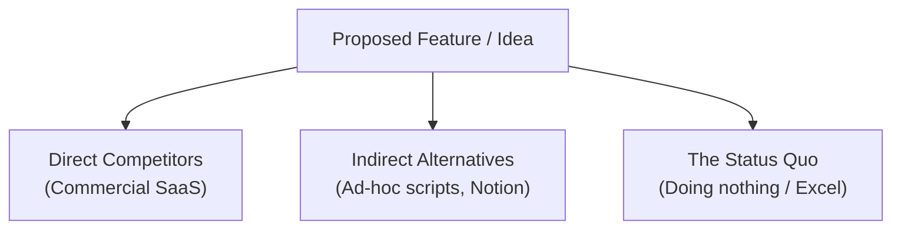
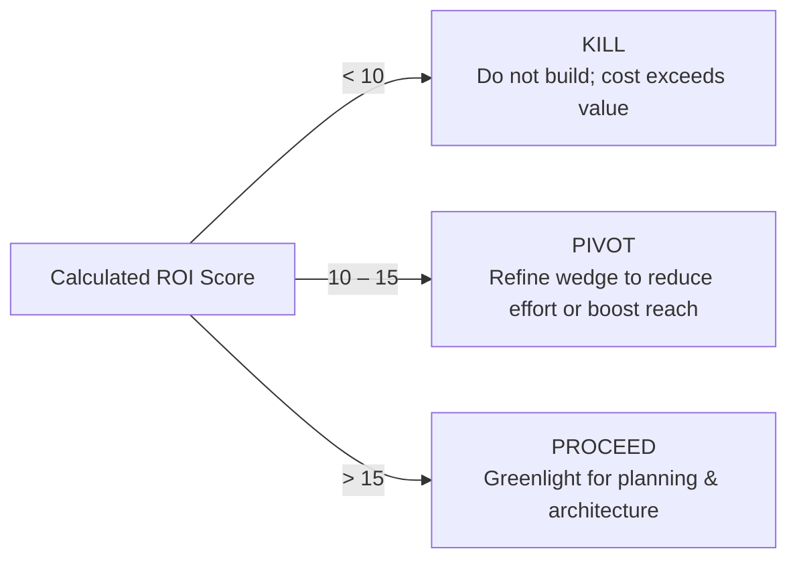

# Validation Rubric & Competitor Gate

This reference document defines the quantitative evaluation frameworks, competitor audit matrices, and hard kill/pivot criteria for the `brainstorm-and-validate` skill.

---

## 1. Competitor & Status Quo Audit

Every new idea competes against the inertia of existing behavior. Never compare an idea solely against direct commercial competitors.



### Competitor Evaluation Matrix

| Category | Typical Example | Why Users Stay There | Vulnerability / Angle of Attack |
| :--- | :--- | :--- | :--- |
| **Status Quo** | Doing nothing, spreadsheet, paper | Zero marginal cost, muscle memory | Manual toil, error-prone, zero automation |
| **Indirect Tools** | Shell script, generic SaaS | Flexible, already paid for | High maintenance, brittle, unshared |
| **Direct Competitors** | Specialized SaaS tools | Feature-rich, established brand | Bloated UI, high price, slow onboarding |

### The "Why Now?" Catalyst
An idea must answer why it is viable today when it wasn't 3 years ago:
* **Technological Shift**: Advent of reliable LLM tool-calling, HTTP MCP servers, or cheap serverless infrastructure.
* **Platform Shift**: New protocols, OS capabilities, or ecosystem marketplaces.
* **Behavioral Shift**: Widespread adoption of remote workflows or agentic code generation.

---

## 2. Quantitative ROI & Feasibility Scoring

Calculate the ROI Score using standardized 1–5 integer scales:

$$\text{ROI Score} = \frac{\text{Pain Intensity} \times \text{Frequency} \times \text{Target Reach}}{\text{Implementation Effort}}$$

### Scoring Definitions

1. **Pain Intensity (1–5)**:
   * 1 = Mild annoyance; easily ignored.
   * 3 = Measurable friction causing occasional wasted hours.
   * 5 = Hair-on-fire blocker causing lost revenue, system outages, or acute stress.
2. **Frequency of Encounter (1–5)**:
   * 1 = Once a quarter or rare edge case.
   * 3 = Weekly routine.
   * 5 = Multiple times daily.
3. **Target Reach (1–5)**:
   * 1 = Niche subset (<5% of target audience).
   * 3 = Substantial segment (25–50%).
   * 5 = Universal to entire ICP (>80%).
4. **Implementation Effort (1–5)**:
   * 1 = Trivial (<1 day; single script or minor refactor).
   * 2 = Low (2–3 days; clean self-contained module).
   * 3 = Moderate (1–2 weeks; standard full-stack feature).
   * 4 = High (1 month; complex integrations, migrations).
   * 5 = Extreme (>1 quarter; novel distributed systems, high platform risk).

### Decision Gate Thresholds



* **Score < 10 (KILL)**: The idea does not deliver enough concentrated value to justify building and maintaining it. Shelve immediately.
* **Score 10–15 (PIVOT)**: The pain is real, but either the implementation is too bloated or the wedge is too broad. Narrow the scope to drop Effort to 1 or 2.
* **Score > 15 (PROCEED)**: High-leverage initiative. Greenlight for architectural specification.

---

## 3. Hard Kill Criteria (Fatal Flaws)

Even with a high ROI score, terminate or fundamentally restructure the idea if any of these fatal conditions exist:

1. **Platform Dependency Trap**: The core value proposition is merely a trivial wrapper around an API that the upstream vendor will launch natively within 6 months.
2. **Intractable Maintenance Blast Radius**: The feature requires ongoing manual coordination, complex dual writes, or high customer support overhead that exceeds team bandwidth.
3. **Unfavorable Economics**: The unit economics (e.g. LLM token cost per operation) exceed the customer's willingness to pay or budget cap.
4. **The "Nice-to-Have" Vitamin Trap**: Users praise the idea verbally in discussions but refuse to allocate time, change habits, or install tools to test an alpha spike.

---

## 4. Rapid Validation Spikes

When an idea scores in the Pivot/Proceed borderline or contains an unknown technical dependency:

1. **Timeboxed Spike**: Spend maximum 4 hours building a throwaway prototype without tests, documentation, or polished styling.
2. **Core Hypothesis Test**: Test only the highest-risk assumption (e.g., "Can MCP query Notion reliably with <200ms latency?").
3. **Spike Harvest**: If hypothesis holds, incorporate learnings into the formal spec; discard spike code. If it fails, terminate early without remorse.

---

## 5. Artifact Template: Validation Scorecard

```markdown
# Validation Scorecard: [Project / Feature Name]

## 1. Executive Verdict
* **Decision**: [PROCEED / PIVOT / KILL]
* **ROI Score**: [Score] / 25
* **Time to Value**: [Minutes to initial user benefit]

## 2. Metric Breakdown
* **Pain Intensity (1-5)**: [Score] — [Evidence/Rationale]
* **Frequency (1-5)**: [Score] — [Evidence/Rationale]
* **Target Reach (1-5)**: [Score] — [Evidence/Rationale]
* **Implementation Effort (1-5)**: [Score] — [Evidence/Rationale]

## 3. Competitor & Alternative Audit
* **Status Quo**: [Current manual workaround]
* **Direct Alternatives**: [Existing tools and their limitations]
* **Our 10x Wedge**: [Single dimension of overwhelming advantage]

## 4. Key Risks & Kill Triggers
* **Risk 1**: [Description & Mitigation]
* **Risk 2**: [Description & Mitigation]
```
