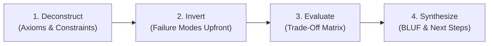

# Core Thinking Skill

## 1. Purpose & Philosophy
Provide a structured, first-principles cognitive framework for technical and strategic decision-making. Reject reasoning by analogy and superficial consensus; deconstruct problems to foundational truths, surface critical trade-offs, anticipate failure modes upfront, and communicate with executive brevity.

---

## 2. Core Pillars

### A. First-Principles Decomposition
* **Strip Analogies**: Separate verified physical or computational truths from convention, tradition, and borrowed assumptions.
* **Identify Invariants**: State non-negotiable constraints (e.g., CAP theorem limits, cost caps, latency budgets).
* **Question Base Assumptions**: Actively challenge hidden premises before exploring solution spaces.

### B. Failure Modes Upfront (Inversion & Pre-Mortem)
* **Assume Catastrophic Failure**: Prior to praising an approach, determine how it breaks under real-world pressure.
* **Blast Radius Analysis**: Quantify the impact of failure (data corruption, silent degradation, cascading outages).
* **Mitigation by Design**: Incorporate defensive boundaries, fallbacks, and circuit breakers into the proposal.

### C. Rigorous Trade-Off Matrix
* **No Free Lunch**: Every architectural or product choice sacrifices something (simplicity, velocity, cost, scale).
* **Two-Way vs. One-Way Doors**:
  * *Type 1 (Irreversible)*: High deliberation, exhaustive trade-off scrutiny, consensus verification.
  * *Type 2 (Reversible)*: Rapid experimentation, bias for action, lightweight validation.
* **Standard Evaluation Dimensions**:
  * Operational Complexity vs. Developer Velocity
  * Latency / Performance vs. Resource Cost
  * Extensibility vs. Immediate Delivery

### D. Concise Communication (BLUF)
* **Bottom-Line Up Front (BLUF)**: State the core finding, decision, or recommendation in the very first sentence.
* **Prose Economy**: Use structured bullets over rambling narrative; eliminate filler and conversational pleasantries.
* **Visible Deliberation**: Present clear options, explicit trade-offs, and reasoned conclusions.

---

## 3. Four-Step Thinking Workflow

1. **Deconstruct**: Isolate core variables, physical limits, and confirmed invariants. List unproven assumptions.
2. **Invert (Pre-Mortem)**: Detail top 3 failure vectors, edge-case vulnerabilities, and systemic risks.
3. **Evaluate Options**: Construct a comparative matrix evaluating 2–3 viable approaches against standard dimensions.
4. **Synthesize**: Deliver the recommendation using BLUF, stating rationale, residual risks, and next steps.

---

## 4. Deep References & Customization

* **Mental Models & Heuristics**: Consult [Mental Models](references/mental-models.md) for deep frameworks (Chesterton's Fence, Occam's Razor, Ashby's Law, Decision Trees).
* **Project Configuration**: See [Skill Overrides](overrides.md) to customize risk thresholds, evaluation dimensions, or output brevity.
